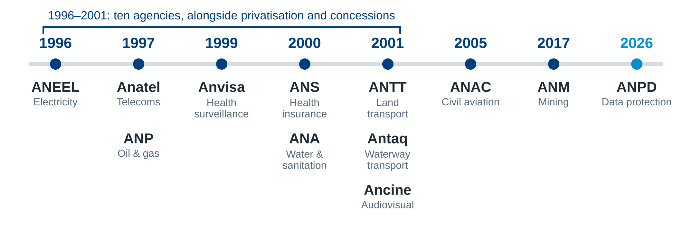
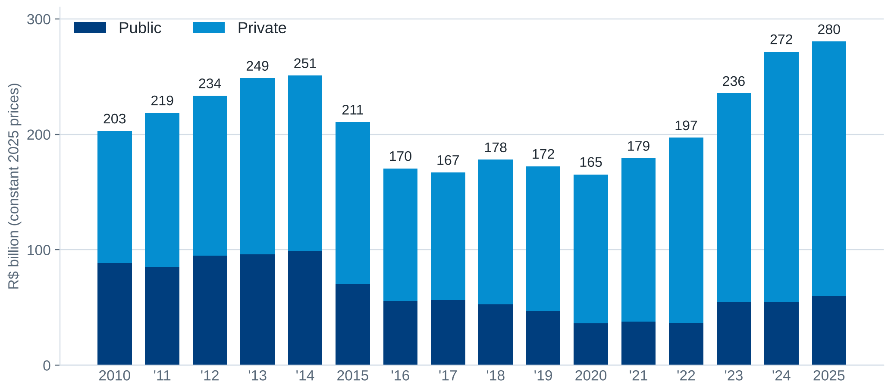
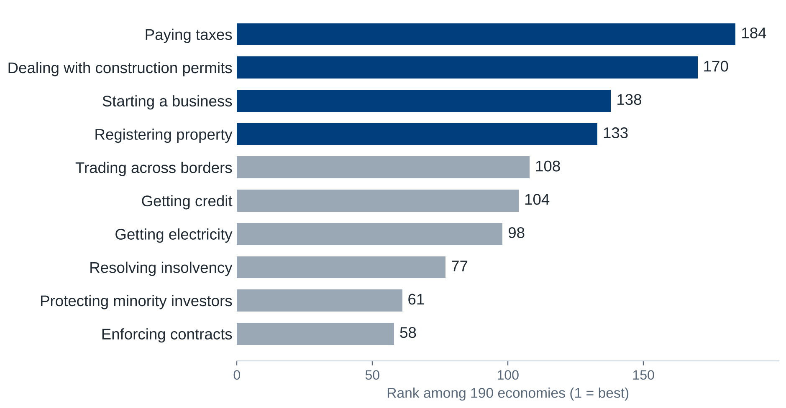
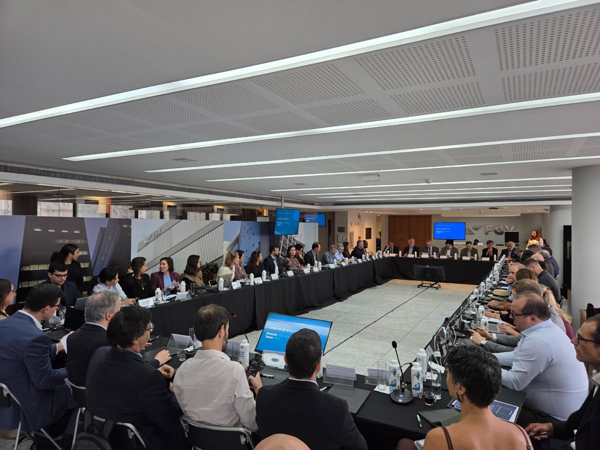
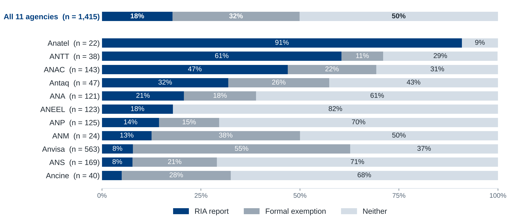
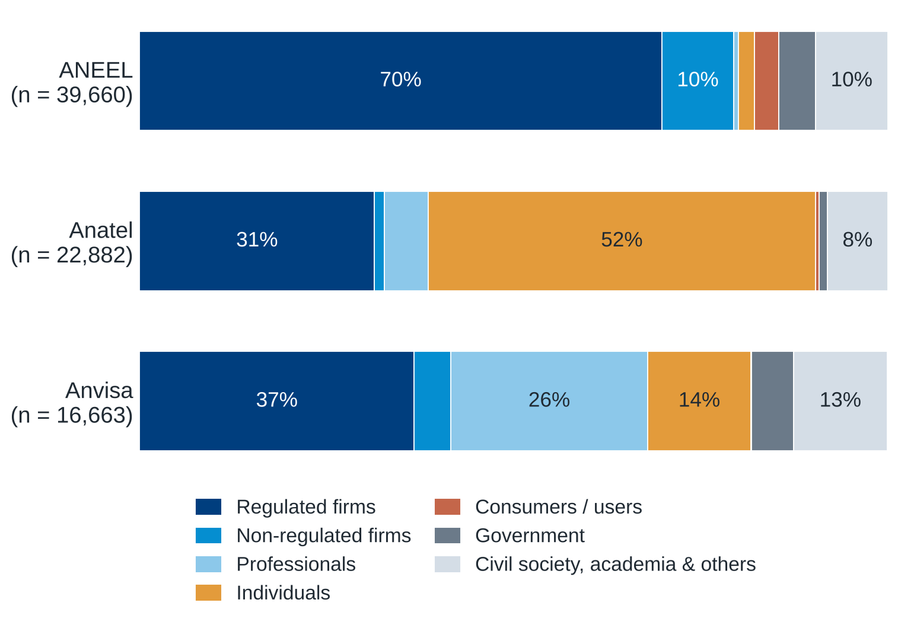
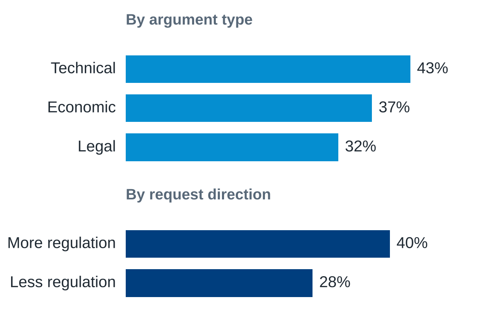
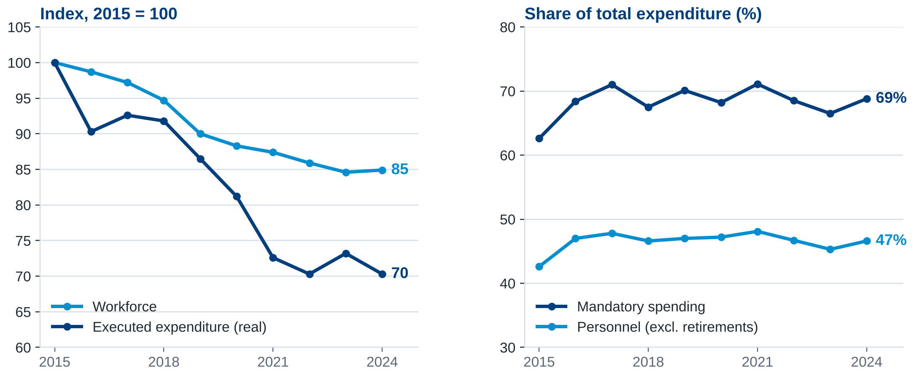
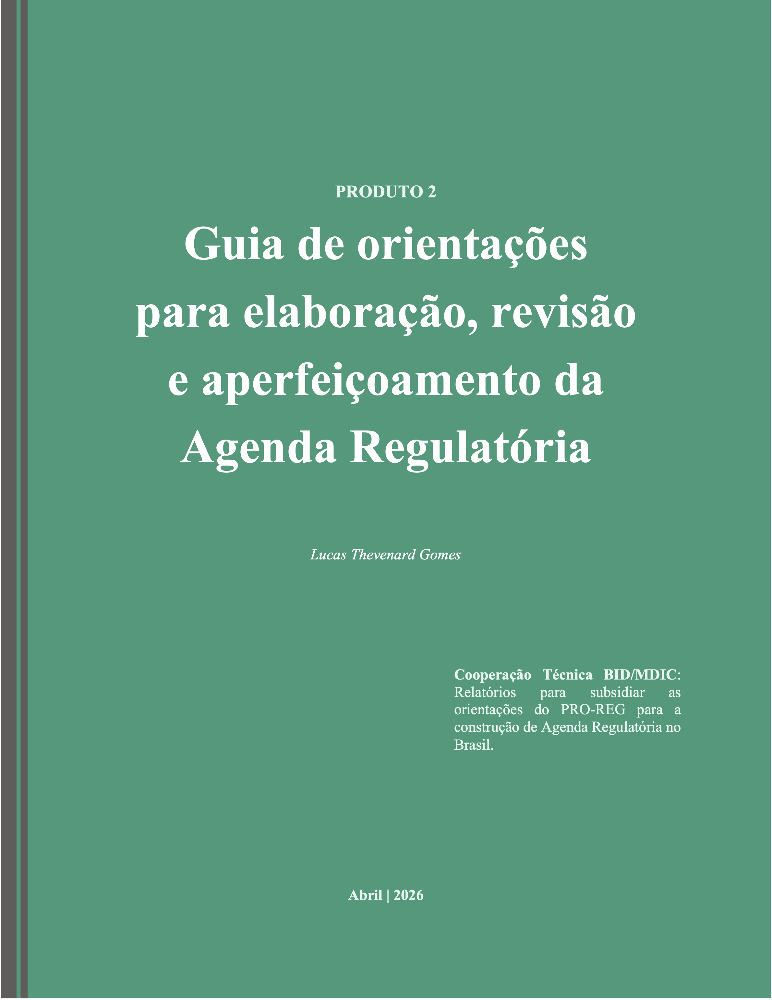

<!-- header: "" -->
<!-- footer: "lucas.gomes@fgv.br | 17/11/2026" -->
<!-- _footer: "" -->
<!-- _class: title -->
<!-- _paginate: false -->

# Regulation, Infrastructure and the Investment Environment in Brazil

**Lucas Thevenard**
FGV Rio Law · Regulation in Numbers project

 

*FGV Global Bridges · 17 November 2026*

<!--
Timing: 10 minutes in total, about 35–40 seconds per slide; the FGV Rio Law, NEASF and MDIC slides can be covered in a few seconds each.

Structure: (1) how the regulatory agency model was built and what it changed; (2) what the investment data show; (3) research on regulation at FGV Rio Law, including what Regulation in Numbers shows about how agencies work in practice.
-->

---

<!-- header: "1. The regulatory state, 1996–2026" -->

## Federal regulatory agencies, 1996–2026

Agencies by year of their creating statute. ANPD: transformed into a regulatory agency by Law 15,352/2026. Sources: federal statutes.

<!--
- The model was created in the context of the 1995 State Reform Master Plan, the constitutional amendments that opened telecoms, oil and gas and other sectors, and the privatisation programme.
- The first agency law is Law 9,427 of 26 December 1996 (ANEEL). The model turns 30 next month.
- Ten agencies were created in six years, in the sectors being privatised or opened to concessions (Telebrás was privatised in 1998).
- Later additions: ANAC (2005), ANM (2017) and, this year, the data protection authority (ANPD), which became the 12th federal agency.

[Sources]
- Law 9,427/1996 (ANEEL); Law 9,472/1997 (Anatel); Law 9,478/1997 (ANP); Law 9,782/1999 (Anvisa); Law 9,961/2000 (ANS); Law 9,984/2000 (ANA); Law 10,233/2001 (ANTT and Antaq); MP 2,228-1/2001 (Ancine); Law 11,182/2005 (ANAC); Law 13,575/2017 (ANM).
- Law 15,352 of 25 February 2026 (ANPD as regulatory agency). ANPD, Nota Técnica nº 42/2026/CGPAR/SRE/ANPD. https://www.gov.br/anpd/pt-br/acesso-a-informacao/participacao-social/outras-acoes/ts-05-2026-nota-tecnica-no-42-2026.pdf/@@display-file/file
-->

---

## What the agency model changed

### Before 1996: ministries and state firms

- Policy, operation and oversight in the same hands
- Tariffs and rules set by the government of the day
- No insulated decision-makers

### Agency model (since 1996)

- Collegiate boards, fixed and staggered terms
- Directors confirmed by the Senate, removable only for cause
- Own revenue from sector fees
- Rulemaking, monitoring and enforcement in one technical body

Purpose: make long-term concession contracts credible to private and foreign investors.

<!--
- The innovation for Brazilian public administration was a body with technical staff, decision-making autonomy and stable mandates, separate from the ministry that sets sector policy.
- The rationale was credible commitment: concession contracts run for 20–35 years, longer than any government.
- Autonomy was later consolidated by the General Law of Regulatory Agencies (Law 13,848/2019), which standardised governance rules for all agencies.

[Sources]
- Law 13,848/2019 (General Law of Regulatory Agencies).
- Thevenard, L. Regulation in Numbers presentation to the GW Regulatory Studies Center (2025), slides/regnum_research_gwrsc.
-->

---

## Reform agenda since 2019

### Sector frameworks

- Sanitation — Law 14,026/2020
- Natural gas — Law 14,134/2021
- Railways by private authorisation — Law 14,273/2021

### Cross-cutting rules and institutions

- General Law of Regulatory Agencies — Law 13,848/2019
- Economic Freedom Act — Law 13,874/2019
- Consumption tax reform — Constitutional Amendment 132/2023, transition 2026–2033
- PRO-REG relaunch (2023) and Regula Melhor strategy (2024)

<!--
- Two kinds of reform: new sector frameworks that opened room for private investment (sanitation, gas, railways), and cross-cutting rules on how regulation is made.
- The tax reform addresses the worst Doing Business indicator (paying taxes); the new consumption taxes are phased in between 2026 and 2033.
- The common thread on the regulatory side is process: impact assessment, consultation, regulatory agendas, ex post review.

[Sources]
- Laws 13,848/2019; 13,874/2019; 14,026/2020; 14,134/2021; 14,273/2021; Constitutional Amendment 132/2023; Decrees 11,738/2023 and 12,150/2024.
-->

---

## Governance tools: from agencies to ministries

<table>
<thead><tr><th>Tool</th><th>Regulatory agencies</th><th>Rest of the federal administration</th></tr></thead>
<tbody>
<tr><td>Public consultation on draft rules</td><td>Used since the agencies' creation; mandatory under Law 13,848/2019</td><td>Required by Decrees 11,243/2022 and 12,002/2024</td></tr>
<tr><td>Regulatory agenda</td><td>Mandatory under Law 13,848/2019</td><td>Extended by Decree 11,243/2022 (at least every two years)</td></tr>
<tr><td>Regulatory impact assessment (RIA)</td><td>Mandatory under Law 13,848/2019</td><td>Mandatory under the Economic Freedom Act (Law 13,874/2019)</td></tr>
<tr><td>Ex post review and consolidation</td><td colspan="2" class="both">Ex post review of rules (Decree 10,411/2020); review and consolidation of the stock of rules below decree level (Decree 10,139/2019, now Decree 12,002/2024)</td></tr>
<tr><td>Central coordination</td><td colspan="2" class="both">PRO-REG (created 2007, relaunched by Decree 11,738/2023) and the Regula Melhor strategy (Decree 12,150/2024)</td></tr>
</tbody>
</table>

<!--
- The procedural tools were first developed in the agencies: notice and comment, public hearings, RIA, regulatory agendas.
- The General Law of Regulatory Agencies (Law 13,848/2019) made consultation, RIA and the regulatory agenda mandatory for all agencies.
- Since 2019 the same tools have been extended by law and decree to ministries and other federal bodies: RIA by the Economic Freedom Act and Decree 10,411/2020; regulatory agendas and public consultation by Decree 11,243/2022; consultation rules consolidated in Decree 12,002/2024.
- Ex post review (ARR) is required by Decree 10,411/2020; Decree 10,139/2019 ordered the review and consolidation of the whole stock of rules below decree level (revoked and replaced by Decree 12,002/2024).
- Implementation outside the agencies is still limited: an Ipea study found 210 RIAs between April 2021 and April 2024 across 146 federal bodies; 181 came from the 32 bodies whose core activity is regulation, and only 29 from the other 114.

[Sources]
- Law 13,848/2019 (arts. 6, 9 and 21); Law 13,874/2019 (art. 5); Decree 10,411/2020 (arts. 12–13); Decree 10,139/2019 (https://legis.senado.leg.br/norma/31777841/publicacao/31778747); Decree 11,243/2022, art. 6 (https://planalto.gov.br/ccivil_03/_ato2019-2022/2022/Decreto/D11243.htm); Decree 12,002/2024 (https://legis.senado.leg.br/norma/38343574/publicacao/38377317).
- Decree 11,738/2023 (PRO-REG); Decree 12,150/2024 (Estratégia Regula Melhor).
- Seixas, L. F. M.; Saccaro Jr., N. L. Ipea, Texto para Discussão 3046 (2025). https://repositorio.ipea.gov.br/bitstream/11058/15962/9/TD_3046_web.pdf
-->
---

<!-- header: "2. Investment and the business environment" -->

## Infrastructure investment in Brazil, 2010–2025

<strong>79%</strong>private share of infrastructure investment in 2025 (56% in 2010)

<strong>US$ 77 bn</strong>FDI inflows in 2025, 5th largest recipient worldwide

<strong>75 auctions</strong>held at B3 in 2025, R$ 244 bn in contracted investment

Sources: ABDIB/EY, Barômetro da Infraestrutura, 15th ed. (Jul. 2026), R$ bn at constant 2025 prices; UNCTAD, World Investment Report 2026; B3 (Jan. 2026).

<!--
- Infrastructure investment reached a record R$ 280 bn in 2025 (constant 2025 prices). The private sector invested R$ 220.5 bn and the public sector R$ 59.9 bn.
- The composition changed: public investment fell from about R$ 99 bn in 2014 to R$ 36–60 bn per year since 2016; private investment now carries the sector.
- Concessions and PPPs: 75 auctions at B3 in 2025 (R$ 243.8 bn in investment commitments), up from 64 auctions in 2024.
- FDI: US$ 77 bn in 2025, up from US$ 63 bn; Brazil was the 5th largest recipient.

[Sources]
- ABDIB/EY-Parthenon. Barômetro da Infraestrutura Brasileira, 15ª edição, julho de 2026, p. 7. https://www.abdib.org.br/wp-content/uploads/2026/08/202607-EYP_15a-Barometro-da-Infraestrutura_VF.pdf
- UNCTAD. "More capital, fewer projects: Latin America's investment paradox" (World Investment Report 2026). https://unctad.org/press-material/more-capital-fewer-projects-latin-americas-investment-paradox
- ANBA, Brazil fifth-largest FDI recipient in 2025. https://anba.com.br/en/tag/unctad-en-2/
- Times Brasil, "B3 bate recorde em 2025", 06/01/2026. https://timesbrasil.com.br/brasil/ibovespa-b3-bate-recorde-em-2025-saiba-qual-foi-o-valor-e-o-numero-de-leiloes-realizados/
-->

---

## Investment levels and needs

<strong>≈ 2.2%</strong>of GDP invested in infrastructure in 2025<em>Inter.B, Carta de Infraestrutura</em>

<strong>16.8%</strong>investment rate (gross fixed capital formation / GDP) in 2025<em>ABDIB / EY, Barômetro da Infraestrutura, 15th ed.</em>

<strong>+R$ 225 bn</strong>additional infrastructure investment needed per year over the next 10 years<em>ABDIB / EY, Barômetro da Infraestrutura, 15th ed.</em>

<!--
- Record investment in absolute terms is still low relative to the economy: about 2.2% of GDP in infrastructure, and an overall investment rate of 16.8% of GDP in 2025.
- Looking ahead, ABDIB/EY estimate that Brazil would need about R$ 225 bn more per year, for ten years, to close the infrastructure gap.

[Sources]
- NeoFeed, citing Inter.B (24ª Carta de Infraestrutura): R$ 266.8 bn or 2.27% of GDP in 2024; projection of 2.19% of GDP for 2025. https://neofeed.com.br/negocios/leiloes-de-infraestrutura-congestionam-calendario-com-previsao-de-r-120-bi-de-investimentos/
- ABDIB/EY-Parthenon. Barômetro da Infraestrutura Brasileira, 15ª edição, julho de 2026, pp. 6–7. https://www.abdib.org.br/wp-content/uploads/2026/08/202607-EYP_15a-Barometro-da-Infraestrutura_VF.pdf
-->
---

## Institutional barriers to doing business

World Bank, Doing Business 2020: Brazil ranked 124th of 190 economies. The series was discontinued in 2021; its successor (B-READY, 2025 edition: 101 economies) does not yet cover Brazil.

<!--
- The last Doing Business report (2020) placed Brazil 124th of 190.
- Worst topics: paying taxes (184th; 1,501 hours per year), construction permits (170th; 338 days), starting a business (138th), registering property (133rd).
- These are the areas targeted by recent reforms: the consumption tax reform (2023, phased in from 2026) and the Economic Freedom Act.

[Sources]
- World Bank. Doing Business 2020, Brazil economy profile. https://subnational.doingbusiness.org/content/dam/doingBusiness/country/b/brazil/BRA-LITE.pdf
- World Bank. Business Ready 2025. https://documents1.worldbank.org/curated/en/099122925140531373/pdf/P178471-62c5108c-22a1-4d37-8fc0-2ee5ec06ab9f.pdf
-->
---
<!-- header: "3. Research on regulation at FGV Rio Law" -->

## Research on regulation at FGV Rio Law

### Graduate Program in Regulation Law

Master's and PhD programme, the only one in Brazil with a concentration in Regulation Law.

Research lines: Regulatory governance, institutions and justice · Economics, intervention and regulatory strategies

<strong>Regulation in Numbers</strong>Empirical research on federal agencies: rulemaking, public participation, impact assessment, budgets and staff

<strong>NEASF</strong>Advanced studies on the regulation of the financial system, with academia, market and regulators

<strong>NEATE</strong>Energy transition research collective, launched in 2024 in collaboration with FGV Europe

<!--
- FGV Rio Law hosts the Graduate Program in Regulation Law (Master's and PhD), the only programme in Brazil with this concentration.
- Applied research is organised in research centres linked to the Center for Research in Law and Economics (CPDE). Three examples: Regulation in Numbers (federal agencies), NEASF (financial regulation) and NEATE (energy transition, coordinated by Rômulo Sampaio, also speaking today).

[Sources]
- FGV Direito Rio, Programa de Pós-graduação stricto sensu em Direito da Regulação. https://direitorio.fgv.br/cursos-internacionais-ppgd
- Monitor Mercantil, "FGV Direito Rio" (Master's in Regulation Law, the only one with this concentration). https://monitormercantil.com.br/fgv-direito-rio/
- FGV Europe, "FGV Rio Law Launches NEATE to Monitor Global Energy Transition in Collaboration with FGV Europe" (12/08/2024). https://www.fgveurope.de/2024/08/12/fgv-rio-law-launches-neate-to-monitor-global-energy-transition-in-collaboration-with-fgv-europe/
-->
---

## NEASF and the Central Bank of Brazil

26th NEASF meeting, co-organised with the Central Bank of Brazil (Rio de Janeiro, 16 October 2026)

<strong>Technical cooperation with the Central Bank</strong>Joint activities on regulation and financial stability in 2026–2027

<strong>Three meetings a year</strong>Academia, market and regulators; reports under the Chatham House Rule. 26th meeting: bank capital and the countercyclical buffer

<strong>Webinar series</strong>Sep. 2026: calibrating a positive neutral countercyclical buffer, with ECB researchers · Dec. 2026: credit receivables funds, payroll loans and supervision

<!--
- NEASF (Center for Advanced Studies on the Regulation of the National Financial System) brings together academia, market participants and regulators.
- In 2026 it established a technical cooperation with the Central Bank of Brazil. The 26th meeting (16 October 2026) was organised jointly with the Central Bank, on the countercyclical capital buffer (CCyB), the usability of capital buffers and bank credit.
- The cooperation includes a new webinar series. 29 September 2026: ECB researchers Giorgia De Nora and Mara Pirovano on the "losses-to-buffer" approach to calibrating a positive neutral CCyB. 11 December 2026: "Originate to distribute: FIDCs, payroll-deductible credit and the supervision of the credit market", with participation of the Central Bank.

[Sources]
- NEASF. Atividades e agenda do NEASF em 2026 (24/09/2026), ~/Repo/NEASF/00_coordenacao/NEASF_Atividades_e_Agenda_2026.pdf.
- NEASF. Plano de Webinar, 11/12/2026 (2026.11.10), ~/Repo/NEASF/01_reunioes_eventos/webinarios/2026-12-11_fidcs_consignado/.
- Photo: 26th meeting, 16/10/2026 (~/Repo/NEASF/01_reunioes_eventos/reunioes/26a_reuniao/fotos/).
-->
---

## NEASF international seminar, Frankfurt

Banking Capital and Burden-Sharing Mechanisms

Who bears the losses when a bank fails?

<strong style="color:white">When:</strong> March 2027 (date to be confirmed)

<strong style="color:white">Format:</strong> one morning, by invitation, 20–30 participants, Chatham House Rule

<strong style="color:white">Partners:</strong> NEASF and FGV Europe, developed with the Central Bank of Brazil

### Topics

- Lessons from Credit Suisse (2023) for bail-in and AT1 instruments
- Creditor hierarchy and the discretion of resolution authorities
- Implications for Brazil's bank resolution bill (PLP 281/2019)
- Expert panel envisaged: BIS, ECB, Central Bank of Brazil and practitioners

<!--
- First international event of NEASF, defined with the Central Bank of Brazil in October 2026, in partnership with FGV Europe.
- Theme: bank capital and loss allocation in resolution. The Credit Suisse case (2023), where AT1 instruments were written down while shareholders received UBS shares, reopened questions on the credibility of bail-in and contractual write-down instruments.
- Brazil's bank resolution bill (PLP 281/2019) is under consideration in Congress; loss allocation is one of the open questions.
- Format: one morning in Frankfurt, March 2027 (date and venue to be confirmed); expert panel followed by a technical roundtable; speakers to be confirmed.

[Sources]
- NEASF. "Banking Capital and Burden-Sharing Mechanisms: event description and programme" (v3, 29/10/2026), ~/Repo/NEASF/01_reunioes_eventos/seminario_internacional/comunicacao/.
- NEASF. Seminário Internacional, contexto e próximos passos (29/10/2026).
-->
---

## Regulatory impact assessment, 2021–2024

Normative acts approved by the 11 agencies. Cost, cost–benefit or cost–effectiveness analysis appeared in only 4 RIAs (about 1.5%). Source: Regulation in Numbers, "Análise dos três anos de regulamentação da AIR no Brasil" (2024).

<!--
- 1,415 normative acts in the first three years of mandatory RIA: 17.8% had an RIA report, 32.1% a formal exemption, and 50.1% neither.
- Large differences across agencies: Anatel used RIA in 91% of its acts; Anvisa, the largest producer of rules (563 acts), used formal exemptions in 55%.
- Three grounds (urgency, low impact, and implementation of a higher norm) account for 87% of exemptions.
- Quantified economic analysis is rare: cost, cost-benefit or cost-effectiveness analysis in only 4 RIAs.

[Sources]
- Regulação em Números (FGV Direito Rio). Análise dos três anos de regulamentação da AIR no Brasil. Relatório de pesquisa, agosto de 2024. https://cdn-conjur.s3.amazonaws.com/uploads/2024/10/analise_dos_tres_anos_de_regulamentacao_da_air_no_brasil_1.pdf
- Figure redrawn from slides/bid/1_uso_e_dispensa_fill.png.
-->

---

## Who participates and what gets accepted

### Participant profiles: share of comments, by agency

### Anatel: comments fully or partially accepted

Left: Regulation in Numbers participation database, consultations and hearings through 2022 (unclassified comments excluded). Right: Anatel, 2000–2026, 42,150 request–response pairs classified with language models (Thevenard, PhD research).

<!--
- Who participates depends on the sector. At ANEEL, regulated firms account for 70% of comments. At Anatel, individuals account for 52%. At Anvisa, health professionals account for 26%.
- What gets accepted: at Anatel, comments with technical arguments are accepted (fully or partially) more often than economic or legal ones: 43%, 37% and 32%.
- Requests for more regulation are accepted more often than requests for less regulation: 40% against 28%.
- For investors: participation is open and used, and well-grounded technical input is what most often changes the final rule.

[Sources]
- Regulation in Numbers (FGV Direito Rio), participation database: ANEEL, Anatel and Anvisa spreadsheets (Contribuições), ~/Repo/dados_participacao/dados_regnum/. Shares computed from Numero_Manifestacoes by Categoria_Participante.
- Thevenard, L. Anatel participation study, full universe 2000–2026 (snapshot 26/07/2026), administrative_response_by_argument_type.csv and administrative_response_by_request_direction.csv (all submissions), ~/Repo/dados_participacao/outputs/analysis/full_universe/2026-07-26/presentation/.
-->
---

## Agency budgets and staff, 2015–2024

<strong>−30%</strong>executed expenditure, inflation-adjusted (R$ 7.0 → 4.9 bn)

<strong>−15%</strong>staff in the 11 agencies (11,175 → 9,483)

<strong>21% → 29%</strong>vacancy rate in positions authorised by law

Source: Regulation in Numbers, budget and workforce report (FGV Rio Law), summarised in Salinas, Assumpção, Thevenard &amp; Ribeiro, GW Regulatory Studies Center (Mar. 2026). A further linear freeze of about 18% hit agency budgets in 2026.

<!--
- Between 2015 and 2024, real executed expenditure fell by almost 30% and staff by 15%.
- Budgets became more rigid: mandatory spending rose from 63% to 69% of the total, and personnel from 43% to 47%. Less room is left for inspections, IT, data and stakeholder engagement.
- The vacancy rate rose from 21.3% to 28.7% (peak of 28.9% in 2023). Before the 2024 hiring cycle, the last broad recruitment was in 2008.
- In 2026, a further linear freeze of about 18% affected agency budgets (Decree 12,990/2026).

[Sources]
- Salinas, N.; Assumpção, C.; Thevenard, L.; Ribeiro, J. S. "Can Regulators Do More with Less? Brazil's Federal Agencies Under Budget and Workforce Pressure." GW Regulatory Studies Center, March 2026, Figures 1 and 2. https://regulatorystudies.columbian.gwu.edu/can-regulators-do-more-less-brazils-federal-agencies-under-budget-and-workforce-pressure
- Regulação em Números. Relatório de orçamento e pessoal das agências reguladoras federais. https://regulacaoemnumeros-direitorio.fgv.br/sites/regulacaoemnumeros-direitorio.fgv.br/files/relatorios/relatorio_orcamento.pdf
- Correio Braziliense, "Corte de verbas pressiona agências reguladoras e ameaça fiscalização" (June 2026); Monitor Mercantil on Decree 12,990 of 29/05/2026.
-->
---

## Technical cooperation with MDIC

Guidance for federal regulators, prepared for the Ministry of Development, Industry, Trade and Services (MDIC), with IDB support

<strong>Regulatory agendas</strong> Guide for preparing, reviewing and improving regulatory agendas · Thevenard, Apr. 2026

<strong>Public participation</strong> Public participation guide for federal regulators · Salinas, 2025

<strong>AI in public participation</strong> Guide on the use of AI in public participation · forthcoming, Dec. 2026

<!--
- Regulation in Numbers researchers support MDIC's Secretariat for Competitiveness and Regulatory Policy, which coordinates regulatory policy (PRO-REG), under a technical cooperation with IDB support.
- Products so far: a guide on preparing, reviewing and improving regulatory agendas (Lucas Thevenard, April 2026) and a public participation guide for federal regulators (Natasha Salinas).
- Next: a guide on the use of AI in public participation, to be launched in December 2026 (cover shown is provisional).

[Sources]
- Thevenard Gomes, L. Guia de orientações para elaboração, revisão e aperfeiçoamento da Agenda Regulatória. Produto 2, Cooperação Técnica BID/MDIC, abril de 2026.
- Salinas, N. S. C. Guia de Participação Social para Reguladores Federais. Produto 3, consultoria para a SCPR/MDIC, 2025. https://www.gov.br/mdic/pt-br/assuntos/reg/relatorios/20260309_guia-de-participacao-social-para-reguladores-federais_vf.pdf/@@download/file
- Seminário "Inteligência artificial e participação social", Cooperação Técnica MDIC–FGV Direito Rio (24/09/2026).
-->
---

<!-- header: "Summary" -->

## Summary

<ul class="steps">
<li><strong>Framework</strong>Procedural tools first built in the agencies (consultation, RIA, agendas) now apply across the federal administration.</li>
<li><strong>Implementation</strong>Uneven: half of agency rules in 2021–2024 had neither an RIA nor a formal exemption, and participation is concentrated among regulated firms.</li>
<li><strong>Capacity</strong>Staff and real spending fell between 2015 and 2024, while private investment in regulated sectors reached record levels.</li>
</ul>

lucas.gomes@fgv.br · regulacaoemnumeros-direitorio.fgv.br

<!--
- Thirty years on, the agency model did what it was designed to do: private capital now accounts for about four-fifths of infrastructure investment.
- The open questions are about implementation and capacity rather than legal design.
-->

---
<!-- _class: title -->
<!-- _header: "" -->
<!-- _footer: "" -->
<!-- _paginate: false -->

# Thank you

<strong>Lucas Thevenard</strong> · lucas.gomes@fgv.br

lthevenard.github.io/post

Slides

<!--
QR code target: https://lthevenard.github.io/post/slides/fgv_global_bridges_2026/fgv_global_bridges_2026.html
-->
