<!-- header: "" -->
<!-- footer: "lucas.gomes@fgv.br | 24/09/2026" -->
<!-- _footer: "" -->
<!-- _class: title -->
<!-- _paginate: false -->

# Usos de IA para auxiliar o processamento e análise de contribuições da sociedade em procedimentos participativos

**Natasha Salinas | Lucas Thevenard**
Setembro - 2026

 

*Cooperação Técnica MDIC-FGV Direito Rio*

---

<!-- header: "Parte I: Conceitos Preliminares" -->
<!-- _footer: "" -->
<!-- _class: section -->
<!-- _paginate: false -->

# Parte I: Conceitos Preliminares

O vocabulário da IA e suas aplicações à Participação Social.

---

<!-- header: "1.1. Propósito deste Seminário e os Fundamentos da Participação Social" -->
<!-- _footer: "" -->
<!-- _class: subsection -->
<!-- _paginate: false -->

## 1.1. Propósito deste Seminário e os Fundamentos da Participação Social

---

## Objetivos do seminário e da oficina

- Compreender as possibilidades e os limites da IA na análise de contribuições da sociedade.
* Examinar necessidades, experiências e dificuldades relatadas por equipes que conduzem processos participativos.
* Experimentar procedimentos de leitura, organização e síntese, com rastreabilidade das fontes e revisão humana.

<!--
[Sources]
- Natasha Salinas. Sugestão de apresentação.docx e Imagens apresentação.pptx, recebidos para o seminário MDIC–FGV em setembro de 2026. Originais preservados em integracao_natasha_2026-09-23/fontes/.
-->

---

<!-- _class: comparison dense -->

## Fundamentos da participação social na regulação

<h3>Legitimidade</h3>

<strong>Como tornar as decisões dos reguladores mais legítimas?</strong>

Participação deliberativa e democrática

<ul><li>Engajamento amplo e diverso</li><li>Diálogos</li><li>Acordos e consensos</li><li>Influência na decisão final</li></ul>

<h3>Transparência</h3>

<strong>Como tornar as decisões dos reguladores mais transparentes?</strong>

Transparência ativa e comunicação efetiva

<ul><li>Informações disponíveis</li><li>Informações claras, precisas e compreensíveis</li></ul>

<h3>Qualidade</h3>

<strong>Como melhorar a qualidade das decisões regulatórias?</strong>

Participação qualificada

<ul><li>Argumentos jurídicos, técnicos, econômicos e científicos</li><li>Conhecimento “situado”</li></ul>

<!--
[Sources]
- Natasha Salinas. Sugestão de apresentação.docx e Imagens apresentação.pptx, recebidos para o seminário MDIC–FGV em setembro de 2026. Originais preservados em integracao_natasha_2026-09-23/fontes/.
-->

---

<!-- _class: table dense -->

Base: material da Natasha

## Mecanismos de participação social na regulação

<table class="mechanisms">
<colgroup><col style="width:29%"><col style="width:25%"><col style="width:22%"><col style="width:24%"></colgroup>
<thead><tr><th>Objetivo da participação</th><th>Formato da participação</th><th>Mecanismo</th><th>Público-alvo</th></tr></thead>
<tbody>
<tr class="selected"><td rowspan="3"><strong>Coleta de informações</strong> Problema, alternativas regulatórias e avaliação <em>ex post</em></td><td>Assíncrona Consulta pontual</td><td><strong>Tomada de subsídios</strong></td><td>Direcionada ou aberta ao público</td></tr>
<tr class="other"><td>Síncrona Atuação pontual</td><td><strong>Reunião participativa</strong></td><td>Restrita a convidados, aberta com restrição ou aberta ao público</td></tr>
<tr class="other"><td>Síncrona Atuação prolongada</td><td><strong>Câmara técnica</strong></td><td>Restrita a convidados</td></tr>
<tr class="selected"><td rowspan="2"><strong>Feedback</strong> Proposta de agenda regulatória, relatório de AIR concluído, proposta normativa ou relatório de ARR concluído</td><td>Assíncrona Consulta pontual</td><td><strong>Consulta pública</strong></td><td>Aberta ao público</td></tr>
<tr class="other"><td>Síncrona Atuação pontual</td><td><strong>Audiência pública</strong></td><td>Aberta ao público</td></tr>
</tbody>
</table>

<!--
[Sources]
- Natasha Salinas. Sugestão de apresentação.docx e Imagens apresentação.pptx, recebidos para o seminário MDIC–FGV em setembro de 2026. Originais preservados em integracao_natasha_2026-09-23/fontes/.
-->

---

<!-- _class: table dense -->

Base: material da Natasha

## Mecanismos mais estruturados e usuais

<table class="mechanisms">
<colgroup><col style="width:29%"><col style="width:25%"><col style="width:22%"><col style="width:24%"></colgroup>
<thead><tr><th>Objetivo da participação</th><th>Formato da participação</th><th>Mecanismo</th><th>Público-alvo</th></tr></thead>
<tbody>
<tr class="selected"><td rowspan="3"><strong>Coleta de informações</strong> Problema, alternativas regulatórias e avaliação <em>ex post</em></td><td>Assíncrona Consulta pontual</td><td><strong>Tomada de subsídios</strong></td><td>Direcionada ou aberta ao público</td></tr>
<tr class="other"><td>Síncrona Atuação pontual</td><td><strong>Reunião participativa</strong></td><td>Restrita a convidados, aberta com restrição ou aberta ao público</td></tr>
<tr class="other"><td>Síncrona Atuação prolongada</td><td><strong>Câmara técnica</strong></td><td>Restrita a convidados</td></tr>
<tr class="selected"><td rowspan="2"><strong>Feedback</strong> Proposta de agenda regulatória, relatório de AIR concluído, proposta normativa ou relatório de ARR concluído</td><td>Assíncrona Consulta pontual</td><td><strong>Consulta pública</strong></td><td>Aberta ao público</td></tr>
<tr class="other"><td>Síncrona Atuação pontual</td><td><strong>Audiência pública</strong></td><td>Aberta ao público</td></tr>
</tbody>
</table>

<!--
[Sources]
- Natasha Salinas. Sugestão de apresentação.docx e Imagens apresentação.pptx, recebidos para o seminário MDIC–FGV em setembro de 2026. Originais preservados em integracao_natasha_2026-09-23/fontes/.
-->

---

<!-- _class: dense -->

## Processo de participação social

<h3>Planejamento</h3>
<ol><li>Definição do escopo e dos objetivos</li><li>Definição do público-alvo</li><li>Definição do formato da participação</li><li>Divulgação da estratégia de participação social</li></ol>

<h3>Condução</h3>
<ol><li>Divulgação, disseminação e treinamento</li><li>Coleta de comentários</li><li>Divulgação dos comentários</li></ol>

<h3>Resposta</h3>
<ol><li class="focus">Leitura e processamento dos comentários e elaboração das respostas</li><li>Publicação, com notificação, das análises das respostas</li><li>Análise da participação social para todo o ciclo regulatório</li></ol>

<!--
[Sources]
- Natasha Salinas. Sugestão de apresentação.docx e Imagens apresentação.pptx, recebidos para o seminário MDIC–FGV em setembro de 2026. Originais preservados em integracao_natasha_2026-09-23/fontes/.
-->

---

<!-- _paginate: hold -->
<!-- _class: dense -->

## Processo de participação social

<h3>Planejamento</h3>
<ol><li>Definição do escopo e dos objetivos</li><li>Definição do público-alvo</li><li>Definição do formato da participação</li><li>Divulgação da estratégia de participação social</li></ol>

<h3>Condução</h3>
<ol><li>Divulgação, disseminação e treinamento</li><li>Coleta de comentários</li><li>Divulgação dos comentários</li></ol>

<h3>Resposta</h3>
<ol><li class="focus"><strong>Leitura e processamento dos comentários e elaboração das respostas</strong></li><li>Publicação, com notificação, das análises das respostas</li><li>Análise da participação social para todo o ciclo regulatório</li></ol>

<!--
[Sources]
- Natasha Salinas. Sugestão de apresentação.docx e Imagens apresentação.pptx, recebidos para o seminário MDIC–FGV em setembro de 2026. Originais preservados em integracao_natasha_2026-09-23/fontes/.
-->

---

<!-- header: "1.2. O que é IA? Definição e distinções conceituais importantes" -->
<!-- _footer: "" -->
<!-- _class: subsection -->
<!-- _paginate: false -->

## 1.2. O que é IA? Definição e distinções conceituais importantes

---

<!-- _class: figure -->

---

<!-- _class: concept -->

## O que é inteligência artificial?

Sistemas computacionais que usam modelos para **inferir, a partir das informações recebidas**, como produzir previsões, recomendações, decisões ou conteúdo.

 

- Podem **reconhecer fala**, **classificar documentos,** **prever demanda** e **gerar textos**.

- As **capacidades** e o **grau de autonomia** variam entre sistemas.

<!--
[Sources]
- Síntese didática: OECD (2024). Explanatory memorandum on the updated OECD definition of an AI system. https://doi.org/10.1787/623da898-en
- https://www.oecd.org/content/dam/oecd/en/publications/reports/2024/03/explanatory-memorandum-on-the-updated-oecd-definition-of-an-ai-system_3c815e51/623da898-en.pdf
- A definição completa relaciona as saídas a objetivos explícitos ou implícitos e à influência em ambientes físicos ou virtuais. Os sistemas também variam quanto à adaptação após a implantação.
- Exemplos de tarefas adaptados da Box 1 do memorando. Não se pressupõe que um único sistema execute todas elas.
-->

---

<!-- _class: concept -->

## Três conceitos distintos e complementares

<h3 data-marpit-fragment>Digitalização</h2>

<h3 data-marpit-fragment>Automação</h2>

<h3 data-marpit-fragment>Inteligência artificial</h2>

---

<!-- _class: comparison -->

## Qual é a diferença entre automação e IA?

### Automação

Diz respeito à **execução da tarefa**, com intervenção humana reduzida.

Um sistema calcula a folha de pagamento aplicando valores e regras cadastrados, sem precisar de IA.

- Exemplo ilustrativo: Akinator.

### Inteligência artificial

Diz respeito às **capacidades de inferência do sistema**.

Uma IA sugere temas para organizar contribuições; o humano responsável confere os textos e decide a classificação final.

- Exemplo ilustrativo: "Me sugira títulos".

<!--
[Sources]
- OECD (2024). Explanatory memorandum on the updated OECD definition of an AI system. https://doi.org/10.1787/623da898-en
- O memorando distingue capacidades e saídas dos sistemas e seus diferentes graus de autonomia. A distinção entre técnica/capacidade e organização da execução é uma síntese didática.
- UK Competition and Markets Authority (2026). Agentic AI and consumers. https://www.gov.uk/government/publications/agentic-ai-and-consumers/agentic-ai-and-consumers
- Exemplos ilustrativos. A geração das sugestões já automatiza uma operação; revisão e decisão humanas não significam ausência de automação de etapas.
-->

---

<!-- _class: table -->

## Digitalização, Automação e IA

| Conceito | O que caracteriza | Exemplos |
|---|---|---|
| **Digitalização** | Converter informações para formato digital. | Digitalizar petições, decisões e certidões de um processo judicial em papel, reunindo os arquivos nos autos eletrônicos. |
| **Automação** | Executar tarefas com intervenção humana reduzida, inclusive por regras predefinidas. | Calcular vencimentos e descontos da folha de pagamento por regras cadastradas. Distribuir processos entre unidades conforme critérios predefinidos. |
| **Inteligência artificial** | Usar modelos para inferir classificações, previsões ou conteúdo. | Classificar relatos de “música de madrugada” como queixas de ruído. Produzir um resumo das queixas apresentadas por um conjunto de moradores de uma localidade afetada por um desastre natural. |

As três operações podem (e devem) coexistir no mesmo processo.

<!--
[Sources]
- OECD (2019). How's Life in the Digital Age?, capítulo 1, Box 1.2. https://www.oecd.org/en/publications/how-s-life-in-the-digital-age_9789264311800-en/full-report/component-3.html
- Digitalização aqui é usada no sentido de conversão para formato digital (digitisation). O uso de tecnologias digitais para mudar atividades e processos (digitalisation) tem alcance mais amplo.
- OECD (2024). Explanatory memorandum on the updated OECD definition of an AI system. https://doi.org/10.1787/623da898-en
- UK Competition and Markets Authority (2026). Agentic AI and consumers. https://www.gov.uk/government/publications/agentic-ai-and-consumers/agentic-ai-and-consumers
- Automação designa a execução de tarefas com intervenção humana reduzida; a folha de pagamento e a distribuição de processos ilustram automação por regras predefinidas. IA também pode integrar uma automação. Os exemplos administrativos são ilustrativos, não resultados de estudo.
-->

---

<!-- _class: comparison -->

## Modelos matemáticos

 

$$
f(x) = y
$$

 

$x$: informações de entrada · $f$: relação entre as variáveis · $y$: resultado

 

### Explicar

Investigar mecanismos que produzem o resultado.

### Descrever ou explorar

Caracterizar relações e descobrir padrões nos dados.

### Prever

Usar uma função para estimar $y$ a partir de $x$, **com baixo erro em casos novos**.

<!--
[Sources]
- Shmueli, G. (2010). To Explain or to Predict? Statistical Science, 25(3), 289–310. https://doi.org/10.1214/10-STS330. Versão da autora: https://arxiv.org/abs/1101.0891
- f(x) = y é uma representação esquemática para situações em que há um resultado de interesse: omite ruído, incerteza e variáveis não observadas. Não define todas as formas de modelagem matemática. A função estimada pelo modelo não equivale necessariamente ao mecanismo gerador; pode-se escrever a previsão como y estimado = f estimada(x).
- O contraste é entre finalidades. As finalidades não correspondem a conjuntos exclusivos de técnicas; a diferença está no propósito, nas hipóteses e nos critérios de avaliação.
- As três colunas distinguem explicar, descrever ou explorar, e prever. Descrição e exploração compartilham uma coluna por afinidade didática, mas não são idênticas. Essas finalidades podem se combinar em uma pesquisa.
- Uma equação ajustada a associações, isoladamente, não identifica causas. A explicação causal requer hipóteses e desenho de pesquisa apropriados.
-->

---

<!-- _class: two-column -->

## Aprendizado de máquina: aprender com exemplos

Uma abordagem de IA em que o modelo aprende padrões a partir de dados durante o treinamento.

### Treinamento

Mensagens e categorias fornecidas por pessoas:

| Mensagem | Categoria |
|---|---|
| “O bar mantém som alto à noite.” | Ruído |
| “A lâmpada do poste está apagada.” | Iluminação |

### Uso do modelo

Uma mensagem nova:

“Não consigo dormir com a música do bar.”

O modelo pode prever a categoria **Ruído**.

<!--
[Sources]
- Google for Developers. Introduction to Machine Learning: Supervised Learning. https://developers.google.com/machine-learning/intro-to-ml/supervised
- Este exemplo apresenta aprendizado supervisionado: associações entre entradas e categorias são aprendidas com dados rotulados. Há outras modalidades de aprendizado de máquina.
- As duas mensagens apenas ilustram o formato dos dados; não constituem uma base suficiente para treinamento nem uma execução realizada. A classificação da mensagem nova é uma saída possível para explicar inferência.
- Distinguir treinamento, avaliação em dados não usados nos ajustes e uso do modelo. Receber uma mensagem durante o uso não implica atualizar automaticamente o modelo.
-->

---

<!-- _class: two-column -->

## Exemplo: prever a aceitação de contribuições

Na pesquisa sobre a Anatel, o objetivo era **prever a aceitação ou recusa de contribuições a partir de seus textos**.

### Treinamento supervisionado

Textos das contribuições — sugestão e justificativa — são convertidos em representações numéricas.

O modelo aprende com esses dados e os **desfechos oficiais conhecidos**.

### Avaliação e uso

O modelo recebe textos de contribuições que não participaram do treinamento e prevê as categorias.

Comparamos as previsões com os desfechos oficiais para **avaliar o desempenho**, de forma a verificar se o modelo, ao ser usado, produziria bons resultados.

<!--
[Sources]
- Lucas Thevenard. Inteligência artificial como assistente na análise de processos regulatórios e participação social. CTIAClima / ABAR, 23/09/2026. Trecho inicial: Modelo preditivo do impacto das contribuições. Fonte local: ../ctiaclima/apresentacao_2026-09-23_v1/apresentacao_ctiaclima_2026-09-23.md e tabela pt6.png.
- Lucas Thevenard Gomes. Dois testes complementares à qualificação — resultados e construção, 06/09/2026, configuração v0.3, especialmente seção 4: O que o modelo recebe e o que ele prevê. /Users/lucasthevenard/Repo/tese_anatel/reconstrucao_preditiva/2026-09-06-v0.3/RELATORIO_EXTENSAO.md
- O preditor recebe a representação numérica do texto de sugestão e justificativa. Respostas e desfechos oficiais não são atributos de entrada para prever um novo caso; a categoria conhecida serve como alvo no treinamento e como referência na avaliação.
- Há dois recortes binários na apresentação histórica: aceitação integral versus recusa; e aceitação integral ou parcial versus recusa. Casos fora de escopo são excluídos em ambos. Não apresentar uma classificação simultânea de todas as categorias como se fosse o teste executado.
- O desfecho previsto é a disposição administrativa registrada, não influência causal, incorporação de cada pedido ou qualidade da contribuição. Separar prever o desfecho de explicar as razões da decisão.
- Aqui se apresenta o funcionamento do aprendizado supervisionado. Os resultados históricos da apresentação da ABAR não equivalem aos controles posteriores de generalização para consultas inteiramente novas; distinguir as versões quando apresentar métricas.
-->

---

<!-- _class: table -->

## Pesquisa Anatel: resultados de validação

<table>
<colgroup><col style="width:40%"><col style="width:15%"><col style="width:15%"><col style="width:16%"><col style="width:14%"></colgroup>
<thead>
<tr><th rowspan="2">Algoritmo</th><th colspan="3">Acurácia por representação do texto</th><th rowspan="2">Melhor F1 (macro)</th></tr>
<tr><th>TF-IDF</th><th>BERT</th><th>GPT (vetores)</th></tr>
</thead>
<tbody>
<tr class="group"><th colspan="5">Aceitação integral × recusa · Base: 2.570 contribuições</th></tr>
<tr><td>Árvore de decisão</td><td>0,71 (71%)</td><td>0,68 (68%)</td><td>0,68 (68%)</td><td>0,71</td></tr>
<tr><td>Regressão logística</td><td>0,73 (73%)</td><td>0,77 (77%)</td><td>0,80 (80%)</td><td>0,80</td></tr>
<tr><td>Random Forest</td><td>0,75 (75%)</td><td>0,78 (78%)</td><td>0,82 (82%)</td><td>0,82</td></tr>
<tr><td>AdaBoost</td><td>0,73 (73%)</td><td>0,73 (73%)</td><td>0,77 (77%)</td><td>0,77</td></tr>
<tr><td>Rede neural (MLP)</td><td>0,76 (76%)</td><td>0,80 (80%)</td><td>0,83 (83%)</td><td>0,83</td></tr>
<tr><td>K-Nearest Neighbors</td><td>0,75 (75%)</td><td>0,77 (77%)</td><td>0,83 (83%)</td><td>0,83</td></tr>
<tr><td class="best-model">Support Vector Machines (SVM)</td><td>0,76 (76%)</td><td>0,80 (80%)</td><td class="best-accuracy">0,84 (84%)</td><td>0,84</td></tr>
</tbody>
</table>

<!--
[Sources]
- Apresentação das métricas: todas as 21 acurácias usam decimal e percentual equivalentes; os sete F1 macro permanecem decimais, pois não são proporções de acertos. O nome SVM e a célula de acurácia com vetores GPT compartilham exatamente o mesmo destaque.
- Lucas Thevenard Gomes. Ideas, interests and the effectiveness of public participation. Texto da qualificação, Tabela 6: Performance of predictive models on the impact classification task (validation scores). Fonte primária: /Users/lucasthevenard/Repo/anatel_consultations/archive - 1st phase/docs/dissertation_extracted.md, linhas 3660–3711; original: dissertation.docx na mesma pasta.
- Destaque visual: célula SVM × GPT (vetores), maior acurácia desta tabela; 0,84 corresponde a 84%. O destaque não se refere à coluna F1. A seleção não implica superioridade geral do algoritmo fora deste recorte. Nomes Random Forest e K-Nearest Neighbors preservados em inglês por preferência do autor.
- Recorte das sete linhas de aceitação integral versus recusa: sete algoritmos, três representações textuais e melhor F1 macro. Os 28 valores originais foram preservados, com duas casas decimais. A coluna GPT-3 do original foi rotulada como GPT (vetores), pois representa vetores dos textos, não um gerador respondendo diretamente à classificação.
- A base completa desta tarefa tem 2.570 contribuições; o conjunto final de avaliação tem 514. O tamanho informado na faixa da tabela é a base completa, não o denominador da acurácia. Conferência: /Users/lucasthevenard/Repo/tese_anatel/reconstrucao_preditiva/2026-09-06-v0.3/RELATORIO_EXTENSAO.md, seção 7.
- Acurácia é a proporção de previsões corretas. F1 macro é a média não ponderada dos F1 das classes; a coluna da fonte informa o melhor valor por algoritmo entre representações. F1 não deve ser interpretado como percentual de acertos.
- O alvo é aceitação integral versus recusa. Aceitações parciais e casos fora de escopo são excluídos deste recorte. O desfecho administrativo não equivale à influência causal da contribuição.
- A referência histórica permite consultas e textos semelhantes em partições diferentes. A tabela não mede desempenho prospectivo em consultas inteiramente novas. Os controles posteriores de cópias e consultas não vistas estão documentados separadamente na reconstrução v0.3.
-->

---

<!-- _class: concept -->

## Inteligência artificial generativa

Modelos que **produzem conteúdo a partir de padrões aprendidos em dados**, em resposta a entradas como instruções, textos ou imagens.

 

Podem gerar **texto, imagens, áudio, vídeo e código**.

Nosso foco será a **geração de texto**: redigir, resumir, reorganizar e comparar documentos.

<!--
[Sources]
- Google for Developers. What is Machine Learning? Seção Generative AI. https://developers.google.com/machine-learning/intro-to-ml/what-is-ml#generative_ai
- A geração de conteúdo pode envolver diferentes modalidades de entrada e saída; um sistema específico não necessariamente oferece todas elas. Código é conteúdo textual, destacado aqui como aplicação frequente.
- A geração se apoia em padrões aprendidos no treinamento e nas entradas disponíveis na execução. Receber um documento durante o uso não implica retreinamento do modelo.
- As tarefas citadas delimitam o foco da apresentação. Produzir texto não garante fidelidade à fonte, correção factual ou adequação à tarefa; esses aspectos serão discutidos nos slides seguintes e na oficina.
-->

---

<!-- _class: concept -->

## Grandes modelos de linguagem (LLMs)

Modelos de aprendizado de máquina treinados com grandes volumes de texto para **processar e gerar linguagem**.

 

A sigla vem de *Large Language Models*. “Grande” se refere à escala do modelo e de seu treinamento.

Um mesmo modelo pode **responder perguntas, resumir, traduzir e redigir textos**, conforme as instruções e os exemplos recebidos.

<!--
[Sources]
- Brown, T. B. et al. Language Models are Few-Shot Learners, 2020. https://arxiv.org/abs/2005.14165
- O artigo apresenta evidência primária de um modelo de linguagem em grande escala executando diferentes tarefas descritas por texto e exemplos, sem atualização dos parâmetros durante essas demonstrações.
- A formulação é uma introdução à família de modelos, sem fixar um limiar universal de parâmetros ou volume de dados para a expressão “grande”. A escala envolve o modelo e os recursos empregados no treinamento.
- O foco aqui é linguagem textual. A definição não implica que todo modelo contemporâneo opere apenas com texto: existem extensões multimodais.
- As tarefas indicam capacidades possíveis, não garantias de correção, fidelidade ou desempenho uniforme. O slide seguinte distingue treinamento e contexto durante o uso.
-->

---

<!-- header: "1.3. Aplicações para Participação Social e outras funções da Administração Pública" -->
<!-- _footer: "" -->
<!-- _class: subsection -->
<!-- _paginate: false -->

## 1.3. Aplicações para Participação Social e outras funções da Administração Pública

---

## Linguagem e trabalho administrativo

A administração trabalha com documentos: recebe demandas, interpreta informações, instrui processos e apresenta razões para agir.

Os LLMs podem apoiar a **leitura, a comparação e a produção desses textos**.

 

### Exemplos:

- **Processamento/Extração/Classificação**: Localizar argumentos em manifestações.
* **Produção**: Preparar uma primeira versão de nota técnica.
* **Interação/Revisão**: Adaptar uma comunicação para linguagem acessível.

<!--
[Sources]
- Guridi, J. A.; Cheyre, C.; Yang, Q. Thoughtful Adoption of NLP for Civic Participation: Understanding Differences Among Policymakers (2025). https://doi.org/10.1145/3711091. Original local SRC0068, seções 4.1–4.3. Entrevistas: necessidades e percepções, sem estimativa causal de produtividade. Os três usos são possibilidades ilustrativas; não são resultados medidos nesta bateria.
-->

---

## IA e Capacidade Administrativa

Ampliar a capacidade de processar informação pode permitir examinar mais demandas e responder em tempo oportuno.

O ganho precisa ser **avaliado no trabalho completo**:

- Tempo de preparação, geração, conferência e correção.
* Qualidade, cobertura e fidelidade da análise.
* Recursos técnicos e competências da equipe.
* Utilidade para o processamento, para a decisão e para a resposta ao cidadão.

<!--
[Sources]
- Guridi, J. A.; Cheyre, C.; Yang, Q. Thoughtful Adoption of NLP for Civic Participation: Understanding Differences Among Policymakers (2025). https://doi.org/10.1145/3711091. Original local SRC0068, seções 4.1–4.3. Entrevistas: necessidades e percepções, sem estimativa causal de produtividade. Critérios propostos para avaliação do fluxo, sem alegação de ganho observado.
-->

---

## Apoio à Tomada de Decisão

- **Discricionariedade, julgamento e vieses (riscos)**: Definir categorias, selecionar o que é relevante e elaborar uma síntese envolve **escolhas interpretativas**.
  * Em uma consulta pública, essas escolhas influenciam a informação que chega a quem decide.
    - Por exemplo, reunir apoio irrestrito e apoio condicionado sob o rótulo “favorável” pode ocultar uma exigência de alteração da proposta.
  * Critérios explícitos e acesso aos textos permitem discutir e revisar essas escolhas.

<!--
[Sources]
- Guridi, J. A.; Cheyre, C.; Yang, Q. Thoughtful Adoption of NLP for Civic Participation: Understanding Differences Among Policymakers (2025). https://doi.org/10.1145/3711091. Original local SRC0068, seções 4.1–4.3. Entrevistas: necessidades e percepções, sem estimativa causal de produtividade. Exemplo didático alinhado ao objeto de D4; não antecipa acurácia nem resultado experimental. Discricionariedade aqui é discutida como espaço de julgamento na organização e interpretação da informação.
-->

---

## Responsabilização e controle dos atos administrativos

Na elaboração de atos administrativos, os agentes responsáveis precisam conseguir explicar **como a análise foi produzida e por que foi aceita**.

- Preservar documentos, versões, instruções e respostas.
- Vincular cada afirmação relevante à sua fonte.
- Registrar critérios, revisões e decisões de correção.
- Definir responsáveis pela conferência e aprovação.
- Permitir contestação e reexame dos resultados.

<!--
[Sources]
- Guridi, J. A.; Cheyre, C.; Yang, Q. Thoughtful Adoption of NLP for Civic Participation: Understanding Differences Among Policymakers (2025). https://doi.org/10.1145/3711091. Original local SRC0068, seções 4.1–4.3. Entrevistas: necessidades e percepções, sem estimativa causal de produtividade. OECD. OECD Guidelines for Citizen Participation Processes (2022). https://doi.org/10.1787/f765caf6-en. Original local SRC0248, passos 5–9, pp. 10–11 e capítulo sobre uso dos insumos e devolutiva. Síntese analítica de requisitos; não constitui exposição de uma obrigação jurídica específica.
-->

---

## IA em consultas públicas: percepções no Reino Unido

Pesquisa do DfT/Thinks (2023): **71 cidadãos em três oficinas**, além de entrevistas com **10 cidadãos experientes em consultas ou correspondências e 9 representantes de organizações**.

* **Aceitação condicional:** maior conforto com a análise interna de consultas do que com a redação de correspondências.
* **Qualidade antes de velocidade:** a economia de tempo só tem valor se os resultados forem precisos.
* **Supervisão e transparência:** necessidade de revisão humana, responsáveis identificáveis e informação sobre o uso da IA.

<!--
[Sources]
- Department for Transport; Thinks Insight & Strategy. Using AI in consultations and correspondence. Setembro de 2023; publicado em 24/11/2023. https://www.gov.uk/government/publications/public-attitudes-to-the-use-of-ai-in-dft-consultations-and-correspondence
- Original local SRC0154: material_conceitual/02_documentos_oficiais/reino_unido/SRC0154__using-ai-in-consultations-and-correspondence.pdf.
- Método e composição: pp. 10–15. Três oficinas deliberativas em Londres (24), Newport (24) e Glasgow (23), com seleção de perfis demográficos variados; 10 entrevistas com cidadãos que haviam respondido a consultas ou enviado correspondências; 9 entrevistas com representantes de organizações que interagem com o DfT. Trabalho de campo: 13/07 a 10/08/2023.
- Aceitação relativa e condições: resumo executivo, pp. 7–8; análise das consultas, pp. 27–30; princípios de qualidade, supervisão, responsabilização e transparência, pp. 38–40. Resultados são percepções qualitativas, não efeitos causais nem estimativas estatísticas da população.
- Nota de conferência: o texto da p. 10 menciona 91 participantes, mas os grupos discriminados e a página oficial informam 71 + 10 + 9; por isso o slide apresenta os grupos separadamente, sem reproduzir o total inconsistente.
-->

---

## "Se trago as mãos distantes do meu peito / É que há distância entre intenção e gesto."

#### Chico Buarque / Ruy Castro - Fado Tropical

 

### Apoio Institucional

Regras de governança, estabelecimento de uma cultura compartilhada e respaldo dos superiores.

### Infraestrutura

Acesso a ferramentas e recursos de infraestrutura, preferencialmente em nível institucional.

### Capacitação

Desenvolvimento de competências e capacidades na equipe, recursos humanos dedicados e materiais de apoio.

### Supervisão e apoio técnico

Equipe de TI e especialistas dedicados para auxiliar a implantação de novas aplicações e solucionar eventuais desafios.

---

<!-- _paginate: hold -->

## "Se trago as mãos distantes do meu peito / É que há distância entre intenção e gesto."

#### Chico Buarque / Ruy Castro - Fado Tropical

 

<h3 style="color: lightgray; "> Apoio Institucional</h3>

Regras de governança, estabelecimento de uma cultura compartilhada e respaldo dos superiores.

<h3 style="color: lightgray; "> Infraestrutura</h3>

Acesso a ferramentas e recursos de infraestrutura, preferencialmente em nível institucional.

### Capacitação

<strong style="color: #0069A6;">Desenvolvimento de competências e capacidades na equipe, recursos humanos dedicados e materiais de apoio.</strong>

<h3 style="color: lightgray; "> Supervisão e apoio técnico</h3>

Equipe de TI e especialistas dedicados para auxiliar a implantação de novas aplicações e solucionar eventuais desafios.

---

<!-- header: "Parte II: Resultados da survey" -->
<!-- _footer: "" -->
<!-- _paginate: false -->
<!-- _class: section -->

Base: material da Natasha

## Parte II: Resultados da survey

Necessidades, experiências e uso de IA na participação social.

<!--
[Sources]
- Natasha Salinas. Sugestão de apresentação.docx, recebida em setembro de 2026. Seleção: Q3.1–Q3.4 e Q4.1, Q4.2, Q4.4, Q4.5.
- Survey Qualtrics: respostas de produção disponíveis em 23/08/2026. Resultados descritivos preliminares, com bases específicas por pergunta.
-->

---

<!-- _footer: "" -->
<!-- _paginate: false -->
<!-- _class: figure no-footer -->

Base: material da Natasha

## Etapas mais onerosas da participação social

Q3.1 · 54 respondentes · base válida para percentuais: 52

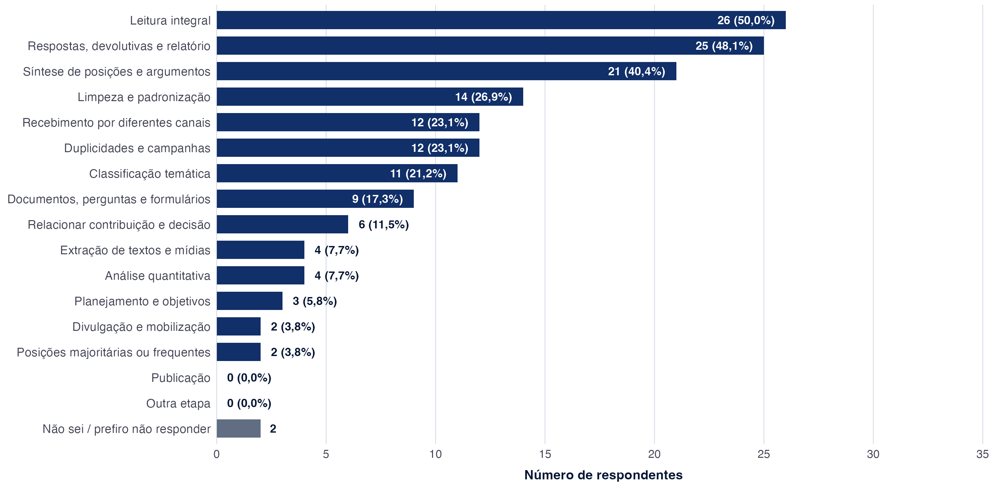

Fonte: survey Qualtrics, respostas de produção disponíveis em 23/08/2026. Elaboração própria. Até 3 escolhas por pessoa. Respostas múltiplas: os percentuais não somam 100%. “Não sei / prefiro não responder” fica fora da base percentual. Inclui respostas concluídas e parciais de produção ao item.

<!--
[Sources]
- Natasha Salinas. Sugestão de apresentação.docx: seleção do gráfico Q3.1. Os pixels da imagem fornecida foram comparados e são idênticos à versão standalone no pacote analysis/2026-08-23_graficos_trilhas_v2/figures/standalone/.
- Figura para slides do mesmo pacote: analysis/2026-08-23_graficos_trilhas_v2/figures/slide_assets/q3/Q3_1_etapas_tempo_esforco.png. Categorias, contagens e percentuais preservados.
- Tabela agregada: analysis/2026-08-23_graficos_trilhas_v2/tables/q3_1.csv. Resultados descritivos preliminares.
-->

---

<!-- _footer: "" -->
<!-- _paginate: false -->
<!-- _class: figure no-footer -->

Base: material da Natasha

## Desafios na condução de processos participativos

Q3.2 · 52 respondentes por item · base válida varia de 45 a 50

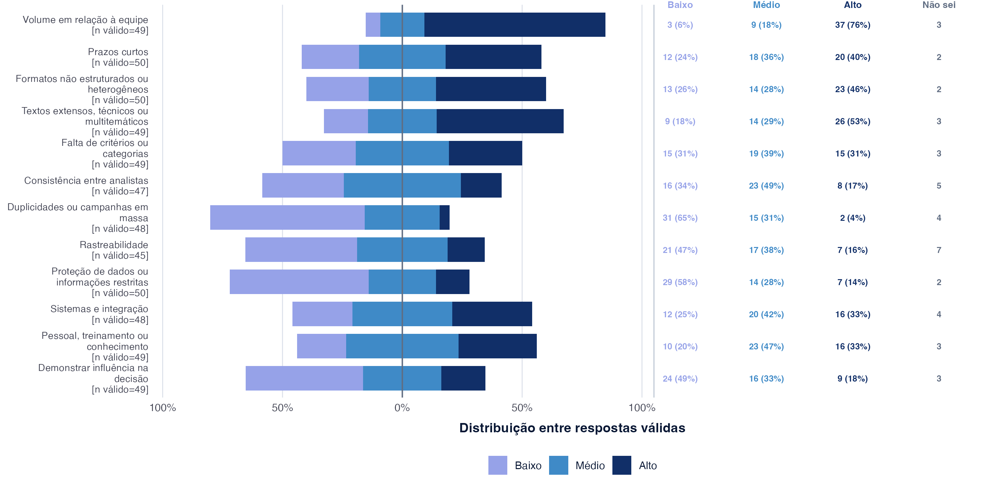

Fonte: survey Qualtrics, respostas de produção disponíveis em 23/08/2026. Elaboração própria. Barras: percentuais entre respostas válidas, excluindo “Não sei avaliar”. A tabela apresenta n e percentual. Inclui respostas concluídas e parciais de produção ao item.

<!--
[Sources]
- Natasha Salinas. Sugestão de apresentação.docx: seleção do gráfico Q3.2. Os pixels da imagem fornecida foram comparados e são idênticos à versão standalone no pacote analysis/2026-08-23_graficos_trilhas_v2/figures/standalone/.
- Figura para slides do mesmo pacote: analysis/2026-08-23_graficos_trilhas_v2/figures/slide_assets/q3/Q3_2_desafios_processos_participacao.png. Categorias, contagens e percentuais preservados.
- Tabela agregada: analysis/2026-08-23_graficos_trilhas_v2/tables/q3_2.csv. Resultados descritivos preliminares.
-->

---

<!-- _class: dense -->

Base: material da Natasha

## Leitura e processamento dos comentários

<h3>Planejamento</h3>
<ol><li>Definição do escopo e dos objetivos</li><li>Definição do público-alvo</li><li>Definição do formato da participação</li><li>Divulgação da estratégia de participação social</li></ol>

<h3>Condução</h3>
<ol><li>Divulgação, disseminação e treinamento</li><li>Coleta de comentários</li><li>Divulgação dos comentários</li></ol>

<h3>Resposta</h3>
<ol><li class="focus">Leitura e processamento dos comentários e elaboração das respostas</li><li>Publicação, com notificação, das análises das respostas</li><li>Análise da participação social para todo o ciclo regulatório</li></ol>

<!--
[Sources]
- Natasha Salinas. Sugestão de apresentação.docx e Imagens apresentação.pptx, recebidos para o seminário MDIC–FGV em setembro de 2026. Originais preservados em integracao_natasha_2026-09-23/fontes/.
-->

---

<!-- _footer: "" -->
<!-- _paginate: false -->
<!-- _class: figure no-footer -->

Base: material da Natasha

## Potencial da IA para apoiar a equipe

Q3.3 · 52 respondentes · percentuais por respondente

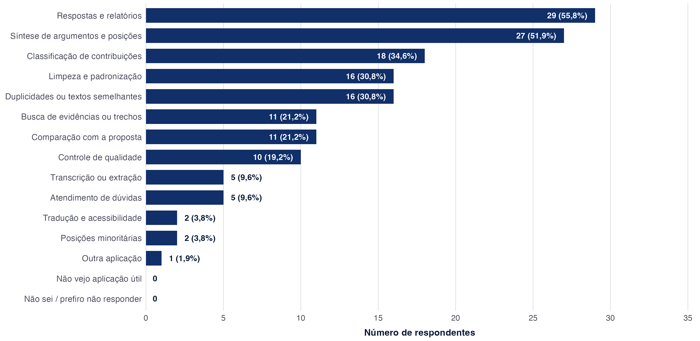

Fonte: survey Qualtrics, respostas de produção disponíveis em 23/08/2026. Elaboração própria. Até 3 escolhas por pessoa. Respostas múltiplas: os percentuais não somam 100%. A base percentual exclui opções não substantivas. Inclui respostas concluídas e parciais de produção ao item.

<!--
[Sources]
- Natasha Salinas. Sugestão de apresentação.docx: seleção do gráfico Q3.3. Os pixels da imagem fornecida foram comparados e são idênticos à versão standalone no pacote analysis/2026-08-23_graficos_trilhas_v2/figures/standalone/.
- Figura para slides do mesmo pacote: analysis/2026-08-23_graficos_trilhas_v2/figures/slide_assets/q3/Q3_3_potencial_ia.png. Categorias, contagens e percentuais preservados.
- Tabela agregada: analysis/2026-08-23_graficos_trilhas_v2/tables/q3_3.csv. Resultados descritivos preliminares.
-->

---

<!-- _footer: "" -->
<!-- _paginate: false -->
<!-- _class: figure no-footer -->

Base: material da Natasha

## Barreiras para experimentar ou utilizar IA

Q3.4 · 52 respondentes · percentuais por respondente

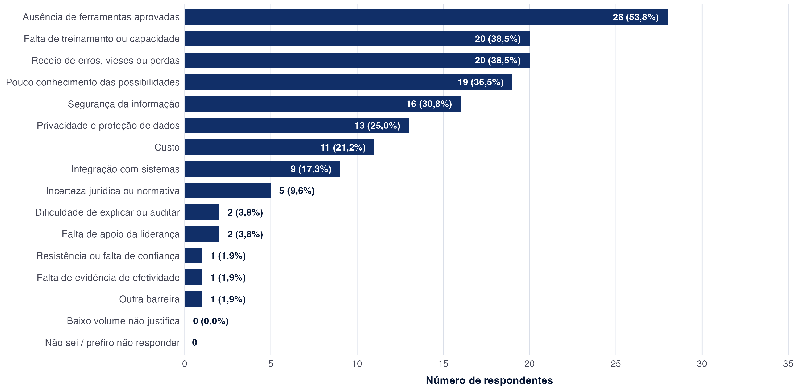

Fonte: survey Qualtrics, respostas de produção disponíveis em 23/08/2026. Elaboração própria. Até 3 escolhas por pessoa. Respostas múltiplas: os percentuais não somam 100%. A base percentual exclui opções não substantivas. Inclui respostas concluídas e parciais de produção ao item.

<!--
[Sources]
- Natasha Salinas. Sugestão de apresentação.docx: seleção do gráfico Q3.4. Os pixels da imagem fornecida foram comparados e são idênticos à versão standalone no pacote analysis/2026-08-23_graficos_trilhas_v2/figures/standalone/.
- Figura para slides do mesmo pacote: analysis/2026-08-23_graficos_trilhas_v2/figures/slide_assets/q3/Q3_4_barreiras_ia.png. Categorias, contagens e percentuais preservados.
- Tabela agregada: analysis/2026-08-23_graficos_trilhas_v2/tables/q3_4.csv. Resultados descritivos preliminares.
-->

---

<!-- _footer: "" -->
<!-- _paginate: false -->
<!-- _class: figure no-footer -->

Base: material da Natasha

## Motivações para o uso de IA na participação social

Q4.1 · 18 respondentes · percentuais por respondente

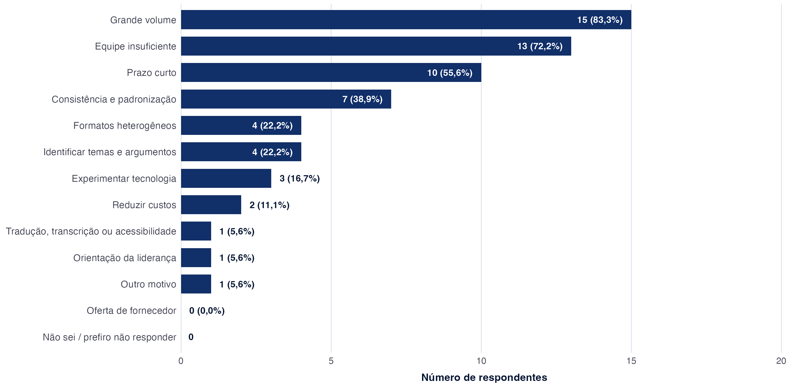

Fonte: survey Qualtrics, respostas de produção disponíveis em 23/08/2026. Elaboração própria. Todas as alternativas aplicáveis. Respostas múltiplas: os percentuais não somam 100%. A base percentual exclui opções não substantivas. Inclui respostas concluídas e parciais de produção ao item.

<!--
[Sources]
- Natasha Salinas. Sugestão de apresentação.docx: seleção do gráfico Q4.1. Os pixels da imagem fornecida foram comparados e são idênticos à versão standalone no pacote analysis/2026-08-23_graficos_trilhas_v2/figures/standalone/.
- Figura para slides do mesmo pacote: analysis/2026-08-23_graficos_trilhas_v2/figures/slide_assets/q4/Q4_1_motivacoes_uso.png. Categorias, contagens e percentuais preservados.
- Tabela agregada: analysis/2026-08-23_graficos_trilhas_v2/tables/q4_1.csv. Resultados descritivos preliminares.
-->

---

<!-- _footer: "" -->
<!-- _paginate: false -->
<!-- _class: figure no-footer -->

Base: material da Natasha

## Atividades em que a IA foi utilizada ou testada

Q4.2 · 18 respondentes · percentuais por respondente

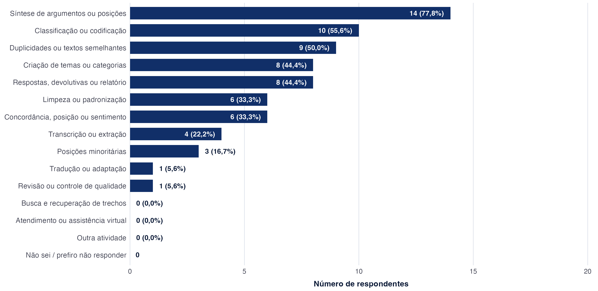

Fonte: survey Qualtrics, respostas de produção disponíveis em 23/08/2026. Elaboração própria. Todas as alternativas aplicáveis. Respostas múltiplas: os percentuais não somam 100%. A base percentual exclui opções não substantivas. Inclui respostas concluídas e parciais de produção ao item.

<!--
[Sources]
- Natasha Salinas. Sugestão de apresentação.docx: seleção do gráfico Q4.2. Os pixels da imagem fornecida foram comparados e são idênticos à versão standalone no pacote analysis/2026-08-23_graficos_trilhas_v2/figures/standalone/.
- Figura para slides do mesmo pacote: analysis/2026-08-23_graficos_trilhas_v2/figures/slide_assets/q4/Q4_2_atividades_uso.png. Categorias, contagens e percentuais preservados.
- Tabela agregada: analysis/2026-08-23_graficos_trilhas_v2/tables/q4_2.csv. Resultados descritivos preliminares.
-->

---

<!-- _footer: "" -->
<!-- _paginate: false -->
<!-- _class: figure no-footer -->

Base: material da Natasha

## Efeitos percebidos do uso de IA

Q4.4 · 18 respondentes por item · base válida varia de 14 a 18

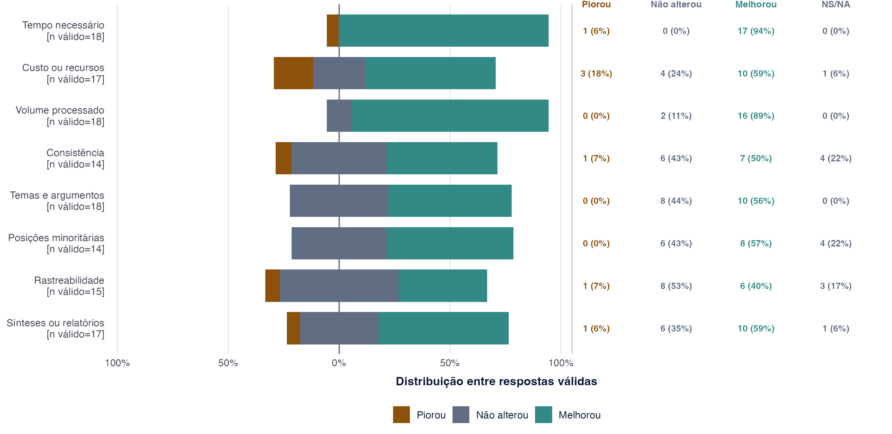

Fonte: survey Qualtrics, respostas de produção disponíveis em 23/08/2026. Elaboração própria. Barras: percentuais entre respostas válidas. NS/NA usa os 18 respondentes de cada item. São percepções relatadas, sem estimativa causal independente. Inclui respostas concluídas e parciais de produção ao item.

<!--
[Sources]
- Natasha Salinas. Sugestão de apresentação.docx: seleção do gráfico Q4.4. Os pixels da imagem fornecida foram comparados e são idênticos à versão standalone no pacote analysis/2026-08-23_graficos_trilhas_v2/figures/standalone/.
- Figura para slides do mesmo pacote: analysis/2026-08-23_graficos_trilhas_v2/figures/slide_assets/q4/Q4_4_efeitos_trabalho.png. Categorias, contagens e percentuais preservados.
- Tabela agregada: analysis/2026-08-23_graficos_trilhas_v2/tables/q4_4.csv. Resultados descritivos preliminares.
-->

---

<!-- _footer: "" -->
<!-- _paginate: false -->
<!-- _class: figure no-footer -->

Base: material da Natasha

## Desafios encontrados nas experiências com IA

Q4.5 · 17 respondentes · base válida para percentuais: 14

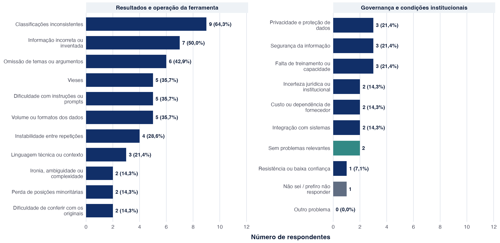

Fonte: survey Qualtrics, respostas de produção disponíveis em 23/08/2026. Elaboração própria. Todas as alternativas aplicáveis. Respostas múltiplas: os percentuais não somam 100%. “Sem problemas relevantes” e “Não sei” ficam fora da base percentual. Os painéis não somam categorias. Inclui respostas concluídas e parciais de produção ao item.

<!--
[Sources]
- Natasha Salinas. Sugestão de apresentação.docx: seleção do gráfico Q4.5. Os pixels da imagem fornecida foram comparados e são idênticos à versão standalone no pacote analysis/2026-08-23_graficos_trilhas_v2/figures/standalone/.
- Figura para slides do mesmo pacote: analysis/2026-08-23_graficos_trilhas_v2/figures/slide_assets/q4/Q4_5_problemas_desafios.png. Categorias, contagens e percentuais preservados.
- Tabela agregada: analysis/2026-08-23_graficos_trilhas_v2/tables/q4_5.csv. Resultados descritivos preliminares.
-->

---

Pedido da Natasha · texto proposto pelo assistente

## Foco da oficina

**Leitura, processamento e análise dos comentários recebidos.**

- Identificar argumentos, propostas, condições e ressalvas nas contribuições.
- Organizar temas e relacionar afirmações aos trechos que lhes dão apoio.
- Elaborar sínteses e notas, confrontando os resultados com as fontes.

Preservar divergências e tornar os resultados verificáveis para apoiar o julgamento humano.

<!--
[Sources]
- Natasha Salinas. Sugestão de apresentação.docx e Imagens apresentação.pptx, recebidos para o seminário MDIC–FGV em setembro de 2026. Originais preservados em integracao_natasha_2026-09-23/fontes/.
-->

---

<!-- header: "Parte III: Oficina" -->
<!-- _footer: "" -->
<!-- _paginate: false -->
<!-- _class: section -->

# Parte III: Oficina

<!--
[Sources]
- Ordem conforme plano aprovado em 23/09/2026.
-->

---

<!-- header: "Parte III: Oficina" -->
<!-- _footer: "" -->
<!-- _paginate: false -->
<!-- _class: subsection -->

## 3.1. Alguns pontos importantes sobre o funcionamento dos LLMs

<!--
[Sources]
- Ordem conforme plano aprovado em 23/09/2026.
-->

---

<!-- _class: comparison -->

## Modelos de linguagem: de onde vem a resposta?

### Aprendizado do modelo

Padrões de linguagem e informações incorporados durante o treinamento.

Por exemplo: vocabulário, estruturas de texto e relações entre conceitos.

### Contexto da tarefa

Instruções, trechos da conversa, documentos e resultados de ferramentas disponibilizados para aquela resposta.

É o que podemos selecionar e organizar ao usar a ferramenta.

A resposta é gerada considerando **o aprendizado do modelo e o contexto disponível**.

<!--
[Sources]
- Google for Developers. What is Machine Learning? Seção Generative AI. https://developers.google.com/machine-learning/intro-to-ml/what-is-ml#generative_ai
- Anthropic. Effective context engineering for AI agents, 2025. https://www.anthropic.com/engineering/effective-context-engineering-for-ai-agents
- O aprendizado do treinamento se incorpora aos parâmetros do modelo; o contexto consiste em informação disponibilizada na execução. A formulação não pressupõe uma base literal de textos consultada automaticamente nem que todo fato foi preservado com fidelidade.
- O contexto efetivamente disponível depende da aplicação e de seus limites: pode incluir partes da conversa, trechos recuperados de documentos, instruções do sistema e resultados de ferramentas. Anexar um arquivo não garante que todo o seu conteúdo esteja disponível de uma vez.
- Usar um documento no contexto de uma resposta não equivale a retreinar imediatamente o modelo. Eventuais políticas de uso de dados para treinamento posterior são questão distinta.
- A disponibilização de fontes e instruções pode orientar a geração, mas a fidelidade e a correção da resposta precisam ser avaliadas. Esse ponto será aprofundado no bloco de riscos e na oficina.
-->

---

<!-- _class: concept -->

## Janela de contexto

É o **limite de informação que o modelo pode processar de uma vez**, medido em tokens — unidades que, no texto, podem ser palavras ou partes delas.

O contexto reúne instruções, conversa disponível e informações de documentos ou ferramentas.

Conversas e documentos longos podem ser resumidos ou ter apenas trechos selecionados pela ferramenta.

Mesmo quando o conteúdo cabe na janela, o modelo pode falhar ao usar informações relevantes. Isso é diferente de faltar espaço ou de a aplicação selecionar apenas alguns trechos.

<!--
[Sources]
- Anthropic. Effective context engineering for AI agents, 2025. https://www.anthropic.com/engineering/effective-context-engineering-for-ai-agents
- Liu, N. F. et al. Lost in the Middle: How Language Models Use Long Contexts. https://arxiv.org/abs/2307.03172
- Tokens são unidades de processamento; no texto, podem corresponder a palavras, partes de palavras, pontuação ou outros segmentos. Não há conversão universal de tokens em palavras ou páginas. Sistemas multimodais têm regras adicionais de contagem.
- Distinguir o limite nominal da janela da capacidade efetiva de usar corretamente toda a informação. Os resultados empíricos do estudo se referem aos modelos e tarefas avaliados; não atribuir uma frequência universal de falha aos modelos atuais.
- Instruções internas, entradas, saídas e eventualmente tokens de raciocínio podem consumir o orçamento conforme o modelo e a aplicação; os limites de entrada e geração devem ser verificados em cada ferramenta. Não fixar aqui um tamanho numérico de janela.
- Algumas aplicações resumem, selecionam ou recuperam partes do material, enquanto outras recusam entradas excessivas. Não afirmar que toda ferramenta corta sempre o início ou que todo arquivo anexado fica integralmente disponível em cada resposta.
- Memória persistente e arquivos armazenados fora da janela são recursos distintos; podem contribuir para respostas futuras quando recuperados para o contexto.
-->

---

## Como o modelo gera texto

**Sequencial**: A resposta é construída sequencialmente, pela geração de novas unidades de texto a partir do contexto e do que já foi produzido.

**Modelo Probabilístico**: Há várias continuações possíveis. O procedimento de geração pode produzir respostas diferentes para a mesma solicitação.

**Excesso de confiança**: Devemos examinar, sempre, repetições, além de uma resposta isolada. A fluência do texto e o tom de segurança não demonstram que a fonte foi representada corretamente.

<!--
[Sources]
- Brown et al. Language Models are Few-Shot Learners (2020). https://arxiv.org/abs/2005.14165. Explicação didática de geração autorregressiva; não diagnóstico causal dos testes.
-->

---

## Como orientar uma tarefa

Um **prompt é a instrução que damos ao sistema.** 

 

Para torná-la verificável, precisamos explicitar:

* **Papel e objetivo:** qual é a função desempenhada e qual trabalho deve ser feito.
* **Fontes e recorte:** quais documentos e questões considerar.
* **Critérios:** o que preservar, distinguir e sinalizar.
* **Formato:** como apresentar a resposta para conferência.

<!--
[Sources]
- Brown et al. Language Models are Few-Shot Learners (2020). https://arxiv.org/abs/2005.14165. Explicação didática de geração autorregressiva; não diagnóstico causal dos testes.
- /Users/lucasthevenard/Repo/participacao_social/ia_participacao_social/testes_minuta_definitiva_2026-09-21/PLANO.md
- Protocolos D1–D4 da bateria vigente de 21/09/2026. Nenhum número de baterias anteriores utilizado.
-->

---

<!-- _class: dense -->

## Pedido genérico e critérios explícitos

**Pedido genérico — exemplo didático**

“Resuma as contribuições.”

**Pedido com critérios — proposta didática**

“Sintetize as posições sobre a questão 1, usando somente as fontes fornecidas. Preserve razões distintas, negações e condições. Indique os IDs que sustentam cada posição e sinalize ambiguidades.”

Nos módulos, veremos os prompts experimentais completos e o que suas respostas efetivamente preservaram.

<!--
[Sources]
- /Users/lucasthevenard/Repo/participacao_social/ia_participacao_social/testes_minuta_definitiva_2026-09-21/PLANO.md
- Protocolos D1–D4 da bateria vigente de 21/09/2026. Nenhum número de baterias anteriores utilizado.
- Exemplos formulados para explicar o conceito de prompt. Não são apresentados como prompts executados ou evidência de melhora.
-->

---

## Diferentes fluxos podem mudar o resultado

**Divisão da tarefa em etapas**: Podemos solicitar primeiro um **inventário com evidências**, depois a redação e, por fim, uma conferência contra os originais.

* As etapas anteriores ficam no contexto da mesma conversa e podem orientar as seguintes.
  - Quando bem empregada, essa estratégia pode reduzir vieses e erros, mas não os elimina completamente.

<!--
[Sources]
- Brown et al. Language Models are Few-Shot Learners (2020). https://arxiv.org/abs/2005.14165. Explicação didática de geração autorregressiva; não diagnóstico causal dos testes.
- /Users/lucasthevenard/Repo/participacao_social/ia_participacao_social/testes_minuta_definitiva_2026-09-21/PLANO.md
- Protocolos D1–D4 da bateria vigente de 21/09/2026. Nenhum número de baterias anteriores utilizado.
-->

---

## Busca em documentos e RAG

Uma aplicação pode buscar trechos em uma coleção de documentos e entregá-los ao modelo para apoiar a resposta. Essa combinação é conhecida como **geração aumentada por recuperação — RAG**.

A qualidade depende da busca, dos trechos selecionados e do uso que o modelo faz deles.

Uma referência citada pode ser inadequada ou insuficiente. É necessário abrir a fonte e conferir o apoio.

RAG não foi uma condição testada nesta bateria.

<!--
[Sources]
- Lewis et al. Retrieval-Augmented Generation for Knowledge-Intensive NLP Tasks (2020). https://arxiv.org/abs/2005.11401.
- /Users/lucasthevenard/Repo/participacao_social/ia_participacao_social/testes_minuta_definitiva_2026-09-21/PLANO.md
- Protocolos D1–D4 da bateria vigente de 21/09/2026. Nenhum número de baterias anteriores utilizado.
-->

---

## Fluxos predefinidos e agentes

Em um **fluxo predefinido**, a sequência de operações é estabelecida previamente: por exemplo, inventário → síntese → revisão.

Em um **sistema com agente**, o modelo pode escolher próximos passos e ferramentas dentro das permissões disponíveis.

Essa autonomia exige definir limites, registros e pontos de intervenção.

A bateria usa procedimentos predefinidos e sessões sem ferramentas. Não compara agentes autônomos.

<!--
[Sources]
- Anthropic. Building effective agents (2024). https://www.anthropic.com/engineering/building-effective-agents. Distinção operacional entre fluxos predefinidos e agentes, não taxonomia universal.
- /Users/lucasthevenard/Repo/participacao_social/ia_participacao_social/testes_minuta_definitiva_2026-09-21/PLANO.md
- Protocolos D1–D4 da bateria vigente de 21/09/2026. Nenhum número de baterias anteriores utilizado.
-->

---

## Diferentes formas de interagir com LLMs

* **Chamadas online via Chat**: o usuário usa uma interface simples que permite fazer pedidos ao modelo por meio de um chat. É possível interagir com arquivos desde que eles estejam na nuvem ou sejam anexados manualmente ao chat, mas a automatização de certas tarefas pode ser difícil.
* **Aplicação instalada e interação com o computador**: Facilita tarefas que possam demandar segmentação de etapas, produção de recursos/arquivos intermediários, entre outras estratégias de automação mais sofisticadas.
* **Chamada a uma API (com ou sem intermediação de uma interface)**: Forma mais sofisticada de gerar fluxos automatizados que sejam controláveis, reproduzíveis e verificáveis. Permite maior grau de otimização e combinação de ferramentas.

<!--
[Sources]
- Brown et al. Language Models are Few-Shot Learners (2020). https://arxiv.org/abs/2005.14165. Explicação didática de geração autorregressiva; não diagnóstico causal dos testes.
- /Users/lucasthevenard/Repo/participacao_social/ia_participacao_social/testes_minuta_definitiva_2026-09-21/PLANO.md
- Protocolos D1–D4 da bateria vigente de 21/09/2026. Nenhum número de baterias anteriores utilizado.
-->

---

<!-- header: "O caso e os materiais da Oficina" -->
<!-- _header: "" -->
<!-- _footer: "" -->
<!-- _class: subsection -->
<!-- _paginate: false -->

## 3.2. O caso e os materiais da Oficina

---

<!-- _class: table -->

## Quatro riscos na análise de textos

| Operação | Problema a examinar |
|---|---|
| Sintetizar | Deixar de fora uma razão relevante |
| Agrupar | Atribuir a todos uma proposta defendida por alguns |
| Redigir uma nota | Apresentar uma sugestão como exigência da minuta |
| Classificar | Tratar apoio condicionado como apoio irrestrito |

<!--
[Sources]
- /Users/lucasthevenard/Repo/participacao_social/ia_participacao_social/testes_minuta_definitiva_2026-09-21/PLANO.md
- Protocolos D1–D4 da bateria vigente de 21/09/2026. Nenhum número de baterias anteriores utilizado.
- Exemplos esquemáticos; os casos literais aparecem ao final dos módulos.
-->

---

## O caso da oficina

Uma minuta simulada propõe condições para o uso de termos ASG na denominação de fundos de investimento.

O corpus reúne **77 contribuições** produzidas a partir de exemplos reais de uma consulta da ESMA.

Vamos ler o texto normativo para compreender o objeto, os percentuais, as condições e os prazos discutidos pelos participantes.

O material é didático: não corresponde a uma consulta ou resolução real da CVM.

<!--
[Sources]
- /Users/lucasthevenard/Repo/participacao_social/ia_participacao_social/testes_minuta_definitiva_2026-09-21/PLANO.md
- Protocolos D1–D4 da bateria vigente de 21/09/2026. Nenhum número de baterias anteriores utilizado.
- Entradas congeladas: minuta e contribuições da versão 21/09/2026.
-->

---

<!-- _class: two-column -->

## OBS: O que é Markdown?

Texto simples com marcações para títulos, listas e destaques.

### Texto marcado

<pre style="font-size:24px;white-space:pre-wrap">## Minuta de Resolução

**Art. 6º** Esta Resolução entra em vigor na data de sua publicação.</pre>

### Documento exibido

#### Minuta de Resolução

**Art. 6º** Esta Resolução entra em vigor na data de sua publicação.

<!--
[Sources]
- /Users/lucasthevenard/Repo/participacao_social/ia_participacao_social/testes_minuta_definitiva_2026-09-21/entradas/01_MINUTA_SIMULADA_AJUSTES_MINIMOS_PARA_REVISAO_2026-09-21.md
- Demonstração da marcação e apresentação do mesmo texto.
-->

---

## Por que usamos Markdown aqui?

Os materiais podem ser inspecionados e editados como texto simples, mantendo títulos, questões e IDs visíveis.

Isso facilita conferir a sequência do documento e a relação entre trechos e fontes.

A escolha **não garante leitura integral ou fidelidade** do modelo. O modo de anexar, extrair e disponibilizar o texto depende da ferramenta.

Conservamos os originais e conferimos os arquivos preparados.

<!--
[Sources]
- /Users/lucasthevenard/Repo/participacao_social/ia_participacao_social/testes_minuta_definitiva_2026-09-21/PLANO.md
- Protocolos D1–D4 da bateria vigente de 21/09/2026. Nenhum número de baterias anteriores utilizado.
-->

---

<!-- _class: table -->

## Formatos processáveis e editáveis para organizar as informações

| Formato | Uso possível |
|---|---|
| Texto / Markdown | Prosa, títulos, listas e identificadores |
| HTML / DOCX | Documentos estruturados, com recursos de formatação |
| CSV / TSV | Tabelas: uma linha por registro, colunas explícitas |
| JSON | Registros com campos e listas, inclusive hierarquias |

<!--
[Sources]
- Comparação didática dos formatos utilizados ou discutidos nesta oficina; não constitui ranking universal de desempenho.
-->

---

## PDF, extração e conferência

Um PDF pode conter texto extraível ou páginas digitalizadas como imagem. No segundo caso, pode ser necessário OCR ou leitura visual.

São três questões diferentes: **formato do arquivo, extração do conteúdo e organização da informação**.

Depois de converter, confira ordem de leitura, tabelas, números, negações, notas e autoria.

PDF não é necessariamente inadequado; texto extraído também pode conter erros.

<!--
[Sources]
- Orientação didática sobre preparação documental. O suporte e os limites devem ser verificados na ferramenta utilizada.
-->

---

<!-- _class: dense -->

## Leitura: denominações abrangidas

> **Art. 1º** Esta Resolução estabelece condições para o uso, na denominação de fundos de investimento, de termos que indiquem características ambientais ou sociais ou objetivos de sustentabilidade ou de impacto. Incluem-se as expressões “ASG”, “ESG”, “verde”, “social”, “sustentável”, “sustentabilidade” e “impacto”, bem como outras expressões que, no contexto da denominação, indiquem essas mesmas características ou objetivos.

<!--
[Sources]
- /Users/lucasthevenard/Repo/participacao_social/ia_participacao_social/testes_minuta_definitiva_2026-09-21/entradas/01_MINUTA_SIMULADA_AJUSTES_MINIMOS_PARA_REVISAO_2026-09-21.md
- Citação literal contínua, conferida por correspondência exata. Minuta simulada · 21/09/2026 · art. 1º.
-->

---

<!-- _class: dense -->

## Leitura: definições da minuta

> **Art. 2º** Para os fins desta Resolução, considera-se:
> 
> I — característica ASG: característica ambiental, social ou de governança assumida pelo fundo como compromisso de cumprimento obrigatório em sua estratégia de investimento; e
> 
> II — investimento sustentável: investimento em atividade econômica que atenda, cumulativamente, aos seguintes requisitos:
> 
> a) contribuição para um objetivo ambiental ou social mensurável;
> 
> b) ausência de dano significativo a outro objetivo dessa mesma natureza; e
> 
> c) observância de práticas de boa governança pela entidade que recebe o investimento.

<!--
[Sources]
- /Users/lucasthevenard/Repo/participacao_social/ia_participacao_social/testes_minuta_definitiva_2026-09-21/entradas/01_MINUTA_SIMULADA_AJUSTES_MINIMOS_PARA_REVISAO_2026-09-21.md
- Citação literal contínua, conferida por correspondência exata. Minuta simulada · 21/09/2026 · art. 2º.
-->

---

<!-- _class: dense -->

## Leitura: o piso de 80%

> **Art. 3º** O fundo abrangido pelo art. 1º deve destinar pelo menos 80% do total de seus investimentos ao atendimento das características ASG ou dos objetivos indicados em sua denominação. O regulamento deve estabelecer esse percentual mínimo como compromisso vinculante da estratégia de investimento.

<!--
[Sources]
- /Users/lucasthevenard/Repo/participacao_social/ia_participacao_social/testes_minuta_definitiva_2026-09-21/entradas/01_MINUTA_SIMULADA_AJUSTES_MINIMOS_PARA_REVISAO_2026-09-21.md
- Citação literal contínua, conferida por correspondência exata. Minuta simulada · 21/09/2026 · art. 3º, caput.
-->

---

<!-- _class: dense -->

## Leitura: investimentos sustentáveis

> § 1º Quando a denominação contiver o termo “sustentável”, “sustentabilidade” ou expressão equivalente a esses termos, pelo menos 50% do total dos investimentos do fundo deverão enquadrar-se na definição de investimento sustentável do art. 2º, II. Esses investimentos devem integrar a parcela de pelo menos 80% prevista no caput.
> 
> § 2º O regulamento e os materiais de divulgação devem informar os percentuais mínimos assumidos e os critérios empregados para demonstrar seu atendimento.

<!--
[Sources]
- /Users/lucasthevenard/Repo/participacao_social/ia_participacao_social/testes_minuta_definitiva_2026-09-21/entradas/01_MINUTA_SIMULADA_AJUSTES_MINIMOS_PARA_REVISAO_2026-09-21.md
- Citação literal contínua, conferida por correspondência exata. Minuta simulada · 21/09/2026 · art. 3º, §§ 1º e 2º.
-->

---

<!-- _class: dense -->

## Leitura: alcance das salvaguardas

> **Art. 4º** As salvaguardas previstas neste artigo aplicam-se à totalidade da carteira dos fundos abrangidos por esta Resolução, inclusive à parcela não compreendida nos percentuais do art. 3º.
> 
> Parágrafo único. Não poderão integrar a carteira valores mobiliários emitidos por sociedades que:
> 
> I — atuem em atividades relacionadas a armas controversas;
> 
> II — cultivem ou produzam tabaco;
> 
> III — sejam consideradas pelo gestor ou por provedor externo de dados como estando em violação dos princípios do Pacto Global das Nações Unidas ou das Diretrizes da OCDE para Empresas Multinacionais;

<!--
[Sources]
- /Users/lucasthevenard/Repo/participacao_social/ia_participacao_social/testes_minuta_definitiva_2026-09-21/entradas/01_MINUTA_SIMULADA_AJUSTES_MINIMOS_PARA_REVISAO_2026-09-21.md
- Citação literal contínua, conferida por correspondência exata. Minuta simulada · 21/09/2026 · art. 4º, caput, parágrafo único e incisos I–III.
-->

---

<!-- _class: dense -->

## Leitura: alcance das salvaguardas

> IV — obtenham pelo menos 1% de suas receitas da prospecção, mineração, extração, distribuição ou refino de carvão mineral ou linhito;
> 
> V — obtenham pelo menos 10% de suas receitas da exploração, extração, distribuição ou refino de petróleo;
> 
> VI — obtenham pelo menos 50% de suas receitas da exploração, extração, fabricação ou distribuição de combustíveis gasosos; ou
> 
> VII — obtenham pelo menos 50% de suas receitas da geração de eletricidade com intensidade superior a 100 gCO₂e/kWh; ou
> 
> VIII — sejam consideradas pelo gestor ou por provedor externo de dados como causadoras de dano significativo a um ou mais objetivos ambientais.

<!--
[Sources]
- /Users/lucasthevenard/Repo/participacao_social/ia_participacao_social/testes_minuta_definitiva_2026-09-21/entradas/01_MINUTA_SIMULADA_AJUSTES_MINIMOS_PARA_REVISAO_2026-09-21.md
- Citação literal contínua, conferida por correspondência exata. Minuta simulada · 21/09/2026 · art. 4º, incisos IV–VI.
-->

---

<!-- _class: dense -->

## Leitura: exigibilidade e fundos novos

> **Art. 5º** As obrigações previstas nesta Resolução serão exigíveis após 3 (três) meses contados da data de sua publicação, observado o disposto no § 2º.
> 
> § 1º Os fundos que iniciarem seu funcionamento a partir da data prevista no caput deverão observar esta Resolução desde o início de suas atividades.

<!--
[Sources]
- /Users/lucasthevenard/Repo/participacao_social/ia_participacao_social/testes_minuta_definitiva_2026-09-21/entradas/01_MINUTA_SIMULADA_AJUSTES_MINIMOS_PARA_REVISAO_2026-09-21.md
- Citação literal contínua, conferida por correspondência exata. Minuta simulada · 21/09/2026 · art. 5º, caput e § 1º.
-->

---

<!-- _class: dense -->

## Leitura: transição dos fundos existentes

> § 2º Os fundos em funcionamento na data prevista no caput terão prazo adicional de 6 (seis) meses para, conforme o caso:
> 
> I — adequar sua carteira, seu regulamento e seus materiais de divulgação às disposições desta Resolução; ou
> 
> II — retirar de sua denominação os termos abrangidos pelo art. 1º e promover os ajustes correspondentes em seus documentos e materiais de divulgação.

<!--
[Sources]
- /Users/lucasthevenard/Repo/participacao_social/ia_participacao_social/testes_minuta_definitiva_2026-09-21/entradas/01_MINUTA_SIMULADA_AJUSTES_MINIMOS_PARA_REVISAO_2026-09-21.md
- Citação literal contínua, conferida por correspondência exata. Minuta simulada · 21/09/2026 · art. 5º, § 2º, incisos I e II.
-->

---

<!-- _class: dense -->

## Leitura: entrada em vigor

> **Art. 6º** Esta Resolução entra em vigor na data de sua publicação.

<!--
[Sources]
- /Users/lucasthevenard/Repo/participacao_social/ia_participacao_social/testes_minuta_definitiva_2026-09-21/entradas/01_MINUTA_SIMULADA_AJUSTES_MINIMOS_PARA_REVISAO_2026-09-21.md
- Citação literal contínua, conferida por correspondência exata. Minuta simulada · 21/09/2026 · art. 6º.
-->

---

## Percentuais, bases e prazos

- **80% e 50%** usam o total dos investimentos como base; os 50% integram a parcela de pelo menos 80%.
- As salvaguardas do art. 4º alcançam a **totalidade da carteira**.
- A minuta distingue entrada em vigor, exigibilidade após três meses e prazo adicional de seis meses para fundos já em funcionamento.

Antes de aceitar uma síntese, confira números, base de cálculo, sujeitos, condições e marcos temporais no texto lido.

<!--
[Sources]
- /Users/lucasthevenard/Repo/participacao_social/ia_participacao_social/testes_minuta_definitiva_2026-09-21/entradas/01_MINUTA_SIMULADA_AJUSTES_MINIMOS_PARA_REVISAO_2026-09-21.md
- Síntese didática dos arts. 3º–6º da minuta fictícia. Não descreve direito vigente.
-->

---

<!-- header: "Testes de problemas recorrentes" -->
<!-- _header: "" -->
<!-- _footer: "" -->
<!-- _class: subsection -->
<!-- _paginate: false -->

## 3.3. Testes de problemas recorrentes

---

<!-- _class: table -->

## Desenho da bateria

| Teste | Objeto | Participantes | Respostas |
|---|---|---:|---:|
| D1 — sínteses | Questão 1 | 75 | 600 |
| D2 — agrupamento | Questão 3 | 70 | 200 |
| D3 — nota/resumo | Questões 1–5 | 60 | 200 |
| D4 — classificação | Questão 2 | 72 | 300 |

GPT-5.5 e GPT-5.6 Sol, esforço médio. Fontes e procedimentos congelados antes das respostas. Os recortes variam conforme a questão e o desenho.

<!--
[Sources]
- /Users/lucasthevenard/Repo/participacao_social/ia_participacao_social/testes_minuta_definitiva_2026-09-21/PLANO.md
- Protocolos D1–D4 da bateria vigente de 21/09/2026. Nenhum número de baterias anteriores utilizado.
-->

---

## D1 · O que uma síntese preserva?

Uma síntese seleciona e comprime informações. **Cobertura** e **fidelidade** são dimensões diferentes: uma frase pode ser fiel e, ainda assim, deixar de fora uma razão relevante.

A literatura de avaliação de resumos distingue relevância, consistência, coerência e fluência. Um texto agradável de ler não satisfaz automaticamente as outras dimensões.

**Literatura:** Fabbri et al. (2021), *SummEval*; Maynez et al. (2020), fidelidade em sumarização.

<!--
[Sources]
- Maynez et al. (2020), On Faithfulness and Factuality in Abstractive Summarization. https://doi.org/10.18653/v1/2020.acl-main.173. SRC0037.
- Fabbri et al. (2021), SummEval. https://doi.org/10.1162/tacl_a_00373. SRC0036.
-->

---

## Risco: omissão de posicionamentos raros

Frequência não é relevância. Uma justificativa apresentada por poucos participantes pode acrescentar uma condição, alternativa ou efeito ainda não considerado.

> Diante disso, se uma síntese tiver pouco espaço, quais perdas seriam aceitáveis? Como justificar essas escolhas?

<!--
[Sources]
- /Users/lucasthevenard/Repo/participacao_social/ia_participacao_social/testes_minuta_definitiva_2026-09-21/D1/PROTOCOLO.json
- /Users/lucasthevenard/Repo/participacao_social/ia_participacao_social/entrega_slides_oficina_2026-09-23/analises/INTEGRIDADE.json
- Resultados preliminares por IA; conferência documental do assistente não equivale a revisão humana.
-->

---

## D1 · Tarefa e contraste

- Questão 1; 75 participantes, distribuídos em dez lotes disjuntos de sete ou oito contribuições.
- **A:** um pedido de síntese direta.
- **B:** inventário com evidências → síntese → revisão na mesma conversa.
- Tetos de 400, 600 e 800 palavras; dois modelos; cinco repetições por combinação e lote.

São 600 saídas finais. B altera o conjunto de instruções e o número de turnos.

<!--
[Sources]
- /Users/lucasthevenard/Repo/participacao_social/ia_participacao_social/testes_minuta_definitiva_2026-09-21/D1/PROTOCOLO.json
- /Users/lucasthevenard/Repo/participacao_social/ia_participacao_social/entrega_slides_oficina_2026-09-23/analises/INTEGRIDADE.json
- Resultados preliminares por IA; conferência documental do assistente não equivale a revisão humana.
-->

---

<!-- _class: dense -->

## D1 · prompt A, etapa 1

> Você integra a equipe técnica responsável pela análise das contribuições recebidas em uma consulta pública sobre nomes de fundos de investimento. Prepare uma síntese das respostas à questão 1: Há necessidade de limites quantitativos para avaliar se a denominação de um fundo é coerente com suas características ou objetivos de investimento? Use a minuta como contexto e as contribuições fornecidas como fontes. Outras seções das contribuições servem para esclarecer remissões e o sentido das respostas à questão 1. Apresente as principais posições e justificativas dos participantes, indicando convergências e divergências. A síntese deve ter até {limite} palavras.

**Fonte:** D1 · condição A · etapa 1.

Em D1, `{limite}` foi substituído por 400, 600 ou 800. A etapa 1 recebeu também o lote integral.

<!--
[Sources]
- /Users/lucasthevenard/Repo/participacao_social/ia_participacao_social/testes_minuta_definitiva_2026-09-21/D1/prompts/A_etapa_1.txt
- Citação literal contínua, conferida por correspondência exata. D1 · condição A · etapa 1.
-->

---

<!-- _class: dense -->

## D1 · prompt B, etapa 1 (1/2)

> Você integra a equipe técnica responsável pela análise das contribuições recebidas em uma consulta pública sobre nomes de fundos de investimento. Prepare uma síntese das respostas à questão 1: Há necessidade de limites quantitativos para avaliar se a denominação de um fundo é coerente com suas características ou objetivos de investimento? Use a minuta como contexto e as contribuições fornecidas como fontes. Outras seções das contribuições servem para esclarecer remissões e o sentido das respostas à questão 1. Antes de redigir a síntese, elabore um inventário das posições, justificativas, propostas e ressalvas relevantes à questão 1.

**Fonte:** D1 · condição B · etapa 1.

Em D1, `{limite}` foi substituído por 400, 600 ou 800. A etapa 1 recebeu também o lote integral.

<!--
[Sources]
- /Users/lucasthevenard/Repo/participacao_social/ia_participacao_social/testes_minuta_definitiva_2026-09-21/D1/prompts/B_etapa_1.txt
- Citação literal contínua, conferida por correspondência exata. D1 · condição B · etapa 1.
-->

---

<!-- _class: dense -->

## D1 · prompt B, etapa 1 (2/2)

> Registre também os argumentos apresentados por poucos participantes. Para cada item, identifique os códigos dos participantes que o sustentam e transcreva um trecho curto de apoio. Diferencie apoio, oposição, apoio condicionado e alternativas, quando presentes. Não atribua ao conjunto uma posição que pertença apenas a parte dele. Nesta etapa, entregue somente o inventário.

**Fonte:** D1 · condição B · etapa 1.

Em D1, `{limite}` foi substituído por 400, 600 ou 800. A etapa 1 recebeu também o lote integral.

<!--
[Sources]
- /Users/lucasthevenard/Repo/participacao_social/ia_participacao_social/testes_minuta_definitiva_2026-09-21/D1/prompts/B_etapa_1.txt
- Citação literal contínua, conferida por correspondência exata. D1 · condição B · etapa 1.
-->

---

<!-- _class: dense -->

## D1 · prompt B, etapa 2

> Com base no inventário e nas fontes desta conversa, redija a síntese das respostas à questão 1 em até {limite} palavras. Apresente as principais posições e justificativas, convergências e divergências. Preserve também os argumentos pouco frequentes que acrescentem razões, propostas ou ressalvas distintas. Mantenha condições e atribuições corretas, sem transformar divergência em consenso.

**Fonte:** D1 · condição B · etapa 2.

Em D1, `{limite}` foi substituído por 400, 600 ou 800. A etapa 1 recebeu também o lote integral.

<!--
[Sources]
- /Users/lucasthevenard/Repo/participacao_social/ia_participacao_social/testes_minuta_definitiva_2026-09-21/D1/prompts/B_etapa_2.txt
- Citação literal contínua, conferida por correspondência exata. D1 · condição B · etapa 2.
-->

---

<!-- _class: dense -->

## D1 · prompt B, etapa 3

> Revise a síntese confrontando-a com as contribuições e o inventário desta conversa. Verifique omissões relevantes, distorções, atribuições e perda de condições ou ressalvas. Corrija o que for necessário sem acrescentar conteúdo sem fonte. Entregue somente a versão final, em até {limite} palavras.

**Fonte:** D1 · condição B · etapa 3.

Em D1, `{limite}` foi substituído por 400, 600 ou 800. A etapa 1 recebeu também o lote integral.

<!--
[Sources]
- /Users/lucasthevenard/Repo/participacao_social/ia_participacao_social/testes_minuta_definitiva_2026-09-21/D1/prompts/B_etapa_3.txt
- Citação literal contínua, conferida por correspondência exata. D1 · condição B · etapa 3.
-->

---

<!-- _class: dense -->

## D1 · Como a cobertura foi medida

A referência preliminar contém **258 unidades de conteúdo**: 213 apoiadas por um ou dois participantes e 45 por três ou mais, nos respectivos lotes.

Para cada resposta, o avaliador classificou cada unidade como **preservada, parcial, ausente ou distorcida**.

O indicador é a fração das unidades em cada classe. Primeiro calculamos por resposta; depois, a média das cinco repetições e dos dez lotes, com pesos iguais.

Fonte: referências e avaliações congeladas de D1; julgamento preliminar por IA.

<!--
[Sources]
- /Users/lucasthevenard/Repo/participacao_social/ia_participacao_social/testes_minuta_definitiva_2026-09-21/D1/PROTOCOLO.json
- /Users/lucasthevenard/Repo/participacao_social/ia_participacao_social/entrega_slides_oficina_2026-09-23/analises/INTEGRIDADE.json
- Resultados preliminares por IA; conferência documental do assistente não equivale a revisão humana.
-->

---

<!-- _footer: "" -->
<!-- _paginate: false -->
<!-- _class: figure no-footer -->

## D1 · Cobertura de conteúdo: comparação dos modelos

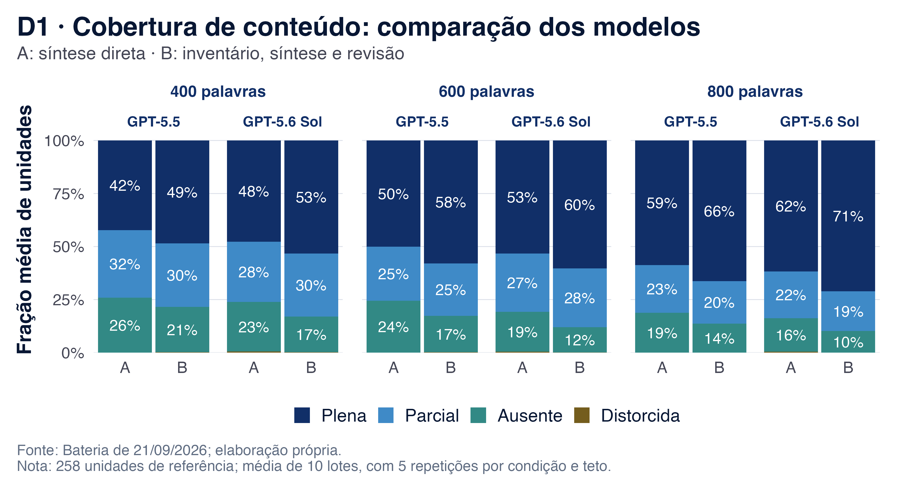

<!--
[Sources]
- /Users/lucasthevenard/Repo/participacao_social/ia_participacao_social/entrega_slides_oficina_2026-09-23/graficos/D1_comparacao_modelos.png
- /Users/lucasthevenard/Repo/participacao_social/ia_participacao_social/entrega_slides_oficina_2026-09-23/scripts/D1_comparacao_modelos.R
- /Users/lucasthevenard/Repo/participacao_social/ia_participacao_social/entrega_slides_oficina_2026-09-23/analises/resumo.csv
-->

---

<!-- _footer: "" -->
<!-- _paginate: false -->
<!-- _class: figure no-footer -->

## D1 excesso teto

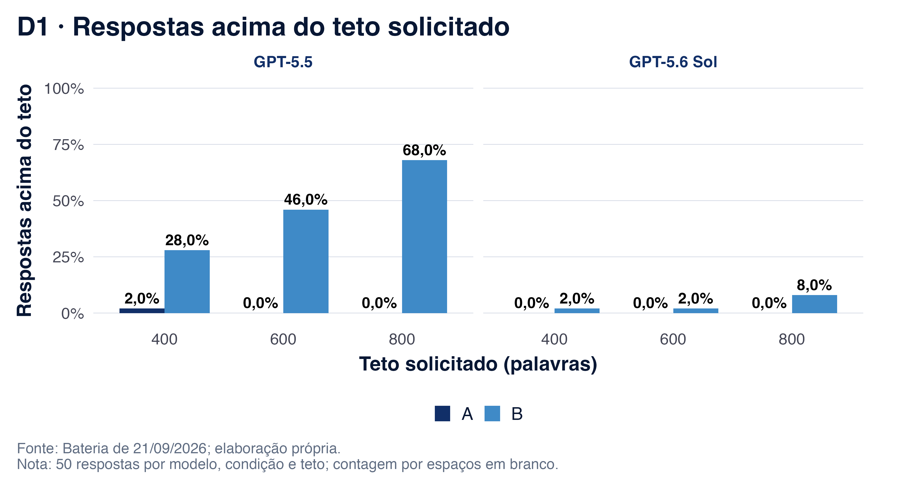

<!--
[Sources]
- /Users/lucasthevenard/Repo/participacao_social/ia_participacao_social/entrega_slides_oficina_2026-09-23/graficos/D1_excesso_teto.png
- /Users/lucasthevenard/Repo/participacao_social/ia_participacao_social/entrega_slides_oficina_2026-09-23/scripts/graficos.R
- /Users/lucasthevenard/Repo/participacao_social/ia_participacao_social/entrega_slides_oficina_2026-09-23/analises/resumo.csv
-->

---

<!-- _footer: "" -->
<!-- _paginate: false -->
<!-- _class: figure no-footer -->

## D1 diferencas lotes

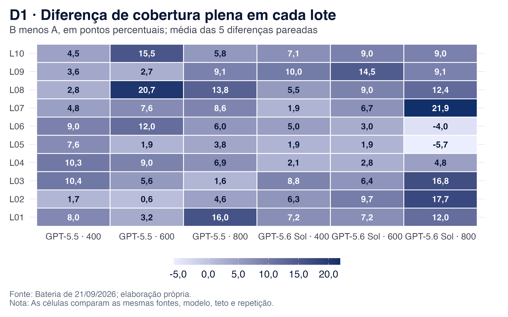

<!--
[Sources]
- /Users/lucasthevenard/Repo/participacao_social/ia_participacao_social/entrega_slides_oficina_2026-09-23/graficos/D1_diferencas_lotes.png
- /Users/lucasthevenard/Repo/participacao_social/ia_participacao_social/entrega_slides_oficina_2026-09-23/scripts/graficos.R
- /Users/lucasthevenard/Repo/participacao_social/ia_participacao_social/entrega_slides_oficina_2026-09-23/analises/resumo.csv
-->

---

<!-- _footer: "" -->
<!-- _paginate: false -->
<!-- _class: figure no-footer -->

## D1 · Ganhos médios de cobertura

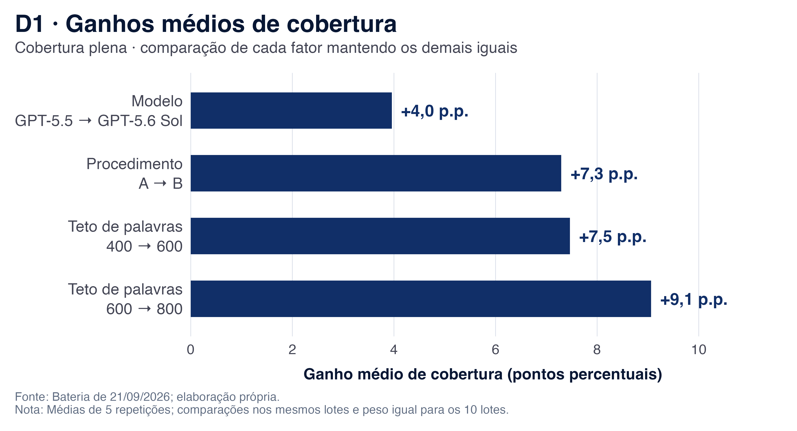

<!--
Diferenças médias descritivas em pontos percentuais. Cada comparação mantém iguais
o lote e os outros dois fatores; média das cinco repetições, seguida de média dos
pares e dos dez lotes, com pesos iguais. O teto solicitado é distinto da extensão
efetiva: esta não está controlada na comparação entre modelo e procedimento.
A: síntese direta. B: inventário, síntese e revisão.
400 → 800 palavras: +16,5256 p.p. (soma dos dois incrementos sem arredondamento).
[Sources]
- /Users/lucasthevenard/Repo/participacao_social/ia_participacao_social/entrega_slides_oficina_2026-09-23/graficos/D1_ganhos_agregados.png
- /Users/lucasthevenard/Repo/participacao_social/ia_participacao_social/entrega_slides_oficina_2026-09-23/scripts/D1_ganhos_agregados.R
- /Users/lucasthevenard/Repo/participacao_social/ia_participacao_social/entrega_slides_oficina_2026-09-23/analises/D1_ganhos_agregados.csv
- /Users/lucasthevenard/Repo/participacao_social/ia_participacao_social/entrega_slides_oficina_2026-09-23/analises/D1_ganhos_por_lote.csv
- /Users/lucasthevenard/Repo/participacao_social/ia_participacao_social/entrega_slides_oficina_2026-09-23/analises/D1_ganhos_agregados_metodo.md
-->

---

<!-- _class: dense -->

## D1 · A razão presente na fonte

> Além de introduzirem proporcionalidade mensurável, em teoria, as regras de limites quantitativos têm o mérito da simplicidade: baseiam-se na alocação pré-contratual de ativos e são simples de verificar pelo regulador (mediante confronto com os relatórios periódicos).

**Fonte:** FS-C008 · questão 1 · entrada D1/L02.

**Para conferir:** a síntese preserva o mecanismo de verificação e a ressalva “em teoria”?

<!--
[Sources]
- /Users/lucasthevenard/Repo/participacao_social/ia_participacao_social/entrega_slides_oficina_2026-09-23/exemplos/fontes/D1_L02_FS-C008.md
- Citação literal contínua, conferida por correspondência exata. FS-C008 · questão 1 · entrada D1/L02.
-->

---

<!-- _class: dense -->

## D1 · Síntese direta: o mecanismo desaparece

> FS-C008 reconheceu a simplicidade e a verificabilidade dos limites, mas recomendou suspender sua implementação até a definição de metodologia comum.

**Fonte:** D1 · L02_R02_gpt-5.6-sol_A_600.

Prompt A: apresentar posições e justificativas em até 600 palavras. O avaliador marcou U027 como **parcial**: a frase conserva a ideia geral, sem mencionar os relatórios periódicos.

<!--
[Sources]
- /Users/lucasthevenard/Repo/participacao_social/ia_participacao_social/testes_minuta_definitiva_2026-09-21/D1/execucoes/L02_R02_gpt-5.6-sol_A_600/SAIDA.md
- Citação literal contínua, conferida por correspondência exata. D1 · L02_R02_gpt-5.6-sol_A_600.
-->

---

<!-- _class: dense -->

## D1 · B recupera o mecanismo

> FS-C008 acrescentou que, em tese, compromissos quantitativos seriam simples de verificar por meio dos relatórios periódicos.

**Fonte:** D1 · L02_R02_gpt-5.6-sol_B_600.

B: inventário → síntese de até 600 palavras → confronto com fontes. U027 foi marcada como **preservada**. O trecho permite conferir a recuperação de “relatórios periódicos” e a ressalva “em tese”.

<!--
[Sources]
- /Users/lucasthevenard/Repo/participacao_social/ia_participacao_social/testes_minuta_definitiva_2026-09-21/D1/execucoes/L02_R02_gpt-5.6-sol_B_600/SAIDA.md
- Citação literal contínua, conferida por correspondência exata. D1 · L02_R02_gpt-5.6-sol_B_600.
-->

---

<!-- _class: dense -->

## D1 · Outra razão da mesma contribuição

> Por fim, acreditamos que a introdução de dois limites diferentes para o uso de “ESG” e “sustentável” pode trazer mais confusão e complexidade de compreensão para os investidores de varejo. Além disso, não há motivo para tratar “sustentável” de forma diferente de outros termos “ESG”; os investidores não percebem uma diferença acentuada entre esses dois termos.

**Fonte:** FS-C008 · questão 1 · entrada D1/L02.

<!--
[Sources]
- /Users/lucasthevenard/Repo/participacao_social/ia_participacao_social/entrega_slides_oficina_2026-09-23/exemplos/fontes/D1_L02_FS-C008.md
- Citação literal contínua, conferida por correspondência exata. FS-C008 · questão 1 · entrada D1/L02.
-->

---

<!-- _class: dense -->

## D1 · B ainda não preserva essa razão

> FS-C089, FS-C017 e FS-C008 pediram clareza sobre os termos abrangidos.

**Fonte:** D1 · L02_R02_gpt-5.6-sol_B_600.

O trecho fala de clareza dos termos. Não explicita a crítica à diferenciação entre “ESG” e “sustentável” pela percepção dos investidores. U021 foi marcada como **ausente em A e B**; a conferência considera as saídas integrais, disponíveis no índice.

<!--
[Sources]
- /Users/lucasthevenard/Repo/participacao_social/ia_participacao_social/testes_minuta_definitiva_2026-09-21/D1/execucoes/L02_R02_gpt-5.6-sol_B_600/SAIDA.md
- Citação literal contínua, conferida por correspondência exata. D1 · L02_R02_gpt-5.6-sol_B_600.
-->

---

## D1 · Auditoria Humana

Necessidade de comparar a lista de razões nas fontes com a síntese. Um ID citado não demonstra que todos os argumentos daquele participante foram adequadamente preservados.

* **Investigações direcionadas**: priorizar a checagem de elementos pouco desenvolvidos nas sínteses apresentadas (o que significa "clareza sobre os termos abrangidos"?).
* **Busca por amostragem**: seleção aleatória de casos de cada pergunta/item para identificar elementos adicionais.
* **Comparação de múltiplas sínteses**: busca de diferenças relevantes entre sínteses.

<!--
[Sources]
- /Users/lucasthevenard/Repo/participacao_social/ia_participacao_social/testes_minuta_definitiva_2026-09-21/D1/PROTOCOLO.json
- /Users/lucasthevenard/Repo/participacao_social/ia_participacao_social/entrega_slides_oficina_2026-09-23/analises/INTEGRIDADE.json
- Resultados preliminares por IA; conferência documental do assistente não equivale a revisão humana.
- Exemplos: D1/L02, GPT-5.6 Sol, R02, A/B, 600 palavras. Unidades U027 e U021.
-->

---

## D2 · Mesmo tema, propostas diferentes

Agrupar contribuições exige distinguir **temas, posicionamentos, condicionantes e alternativas**.

Um nome de grupo pode parecer claro e ainda encobrir diferenças relevantes. Li et al. (2025) discutem esse limite na avaliação de modelos de tópicos: a legibilidade/clareza do rótulo não implica em uma compreensão substantiva do conjunto abrangido.

Na consulta, é preciso conferir tanto o que o grupo diz quanto quais participantes sustentam cada proposição.

<!--
[Sources]
- Li et al. (2025), Large Language Models Struggle to Describe the Haystack without Human Help. https://arxiv.org/abs/2502.14748. SRC0028. Conceitos de avaliação temática; resultados do artigo não transferidos para esta bateria.
-->

---

## D2 · Riscos: categorias inconsistentes, agrupamentos indevidos, omissões

Questão 3: piso adicional de 50%. São 70 participantes, em dez lotes de sete; dois modelos e cinco repetições: **200 tabelas**.

**A:** agrupar propostas semelhantes, com nome, descrição e IDs.

**B:** a mesma tarefa, com instruções explícitas para separar posições, condições e alternativas e conferir cada ID.

> Como detectar uma proposta atribuída a todo um grupo, mas defendida apenas por parte dele?

<!--
[Sources]
- /Users/lucasthevenard/Repo/participacao_social/ia_participacao_social/testes_minuta_definitiva_2026-09-21/D2/PROTOCOLO.json
- /Users/lucasthevenard/Repo/participacao_social/ia_participacao_social/entrega_slides_oficina_2026-09-23/analises/INTEGRIDADE.json
- Resultados preliminares por IA; conferência documental do assistente não equivale a revisão humana.
-->

---

<!-- _class: dense -->

## D2 · prompt A, etapa 1

> Você integra a equipe técnica de análise de uma consulta pública sobre nomes de fundos de investimento. Use exclusivamente a minuta e as contribuições fornecidas. O lote identifica a questão em análise; outras seções esclarecem suas remissões e ambiguidades. Agrupe as contribuições por propostas semelhantes sobre a questão em análise. Entregue uma tabela com nome do grupo, descrição curta da proposta e IDs dos participantes.

**Fonte:** D2 · condição A · etapa 1.

A primeira etapa recebeu também a minuta e as contribuições integrais do lote.

<!--
[Sources]
- /Users/lucasthevenard/Repo/participacao_social/ia_participacao_social/testes_minuta_definitiva_2026-09-21/D2/prompts/A_etapa_1.txt
- Citação literal contínua, conferida por correspondência exata. D2 · condição A · etapa 1.
-->

---

<!-- _class: dense -->

## D2 · prompt B, etapa 1 (1/2)

> Você integra a equipe técnica de análise de uma consulta pública sobre nomes de fundos de investimento. Use exclusivamente a minuta e as contribuições fornecidas. O lote identifica a questão em análise; outras seções esclarecem suas remissões e ambiguidades. Agrupe as contribuições por propostas semelhantes sobre a questão em análise. Entregue uma tabela com nome do grupo, descrição curta da proposta e IDs dos participantes. Distinga tema, posição, condição e alternativa. Duas contribuições sobre o mesmo tema não defendem necessariamente a mesma proposta. Identifique o que cada participante expressamente propõe e a que objeto se refere.

**Fonte:** D2 · condição B · etapa 1.

<!--
[Sources]
- /Users/lucasthevenard/Repo/participacao_social/ia_participacao_social/testes_minuta_definitiva_2026-09-21/D2/prompts/B_etapa_1.txt
- Citação literal contínua, conferida por correspondência exata. D2 · condição B · etapa 1.
-->

---

<!-- _class: dense -->

## D2 · prompt B, etapa 1 (2/2)

> Diferencie apoio, comentário sobre aplicação, sugestão complementar e condição expressa; o silêncio não autoriza inferir apoio nem oposição. Forme cada grupo em torno de proposta comum sustentada por todos os IDs associados. Explicite diferenças substantivas e seus respectivos IDs; use subgrupos ou linhas separadas se necessário. Um participante pode aparecer em mais de um grupo. Uma sugestão de melhoria não se torna condição indispensável; concordância com um cálculo não implica apoio geral à exigência nem adesão às justificativas de outro. Confira título, descrição e IDs de cada linha contra as fontes, preservando negações, ressalvas e alternativas. Entregue somente a tabela final nas três colunas solicitadas.

**Fonte:** D2 · condição B · etapa 1.

A primeira etapa recebeu também a minuta e as contribuições integrais do lote.

<!--
[Sources]
- /Users/lucasthevenard/Repo/participacao_social/ia_participacao_social/testes_minuta_definitiva_2026-09-21/D2/prompts/B_etapa_1.txt
- Citação literal contínua, conferida por correspondência exata. D2 · condição B · etapa 1.
-->

---

<!-- _footer: "" -->
<!-- _paginate: false -->
<!-- _class: figure no-footer -->

## D2 cobertura

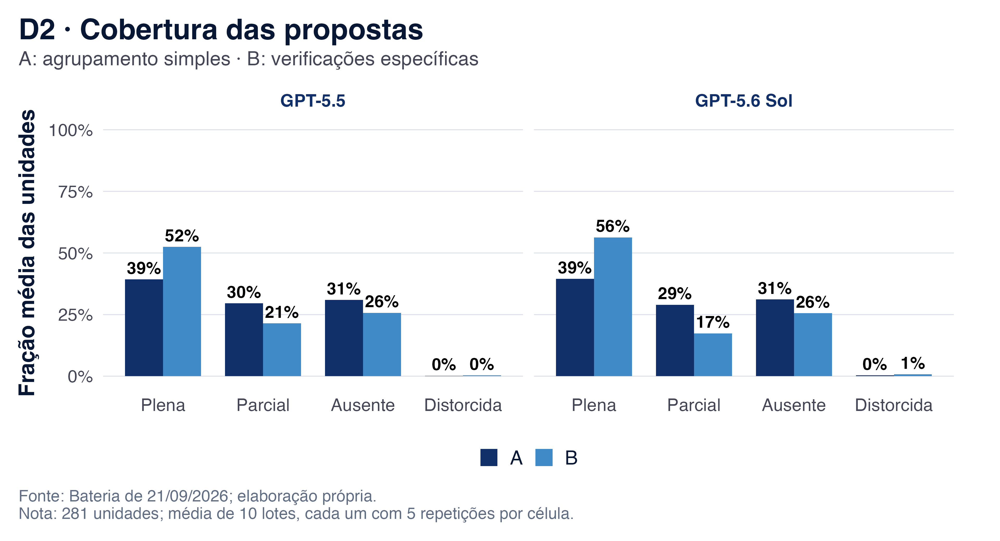

<!--
[Sources]
- /Users/lucasthevenard/Repo/participacao_social/ia_participacao_social/entrega_slides_oficina_2026-09-23/graficos/D2_cobertura.png
- /Users/lucasthevenard/Repo/participacao_social/ia_participacao_social/entrega_slides_oficina_2026-09-23/scripts/graficos.R
- /Users/lucasthevenard/Repo/participacao_social/ia_participacao_social/entrega_slides_oficina_2026-09-23/analises/resumo.csv
-->

---

<!-- _footer: "" -->
<!-- _paginate: false -->
<!-- _class: figure no-footer -->

## D2 lotes

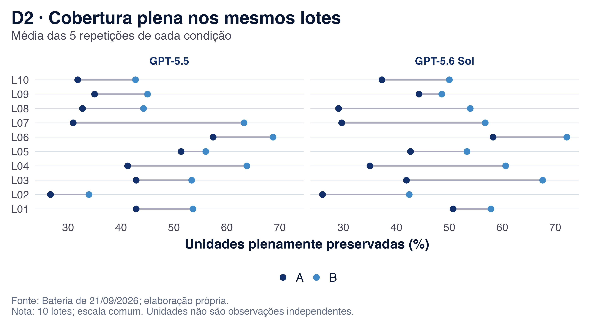

<!--
[Sources]
- /Users/lucasthevenard/Repo/participacao_social/ia_participacao_social/entrega_slides_oficina_2026-09-23/graficos/D2_lotes.png
- /Users/lucasthevenard/Repo/participacao_social/ia_participacao_social/entrega_slides_oficina_2026-09-23/scripts/graficos.R
- /Users/lucasthevenard/Repo/participacao_social/ia_participacao_social/entrega_slides_oficina_2026-09-23/analises/resumo.csv
-->

---

<!-- _class: dense -->

## D2 · Quem propôs a alternativa relativa?

> Se, ainda assim, o regulador quiser prosseguir, sugerimos medir a proporção de investimentos sustentáveis do fundo em relação à proporção correspondente em seu índice de referência ou universo de investimento, usando a mesma metodologia de avaliação. A palavra “sustentável” poderia ser usada desde que o fundo se comprometesse a manter percentual significativamente superior ao de seu universo de investimento, mas em nenhum caso tão alto quanto 50%.

**Fonte:** FS-C006 · questão 3 · entrada D2/L01.

<!--
[Sources]
- /Users/lucasthevenard/Repo/participacao_social/ia_participacao_social/entrega_slides_oficina_2026-09-23/exemplos/fontes/D2_L01_FS-C006.md
- Citação literal contínua, conferida por correspondência exata. FS-C006 · questão 3 · entrada D2/L01.
-->

---

<!-- _class: dense -->

## D2 · Uma objeção diferente

> O limite adicional de 50% para o uso de “sustentável” ou de termos equivalentes também não parece viável antes que seja esclarecida a metodologia de aplicação da definição de investimento sustentável do art. 2º, II, e enquanto os dados disponíveis permanecerem insuficientes.

**Fonte:** FS-C011 · questão 3 · entrada D2/L01.

A questão 3 de FS-C011 desenvolve problemas de metodologia e dados. Não propõe a comparação relativa com índice formulada por FS-C006.

<!--
[Sources]
- /Users/lucasthevenard/Repo/participacao_social/ia_participacao_social/entrega_slides_oficina_2026-09-23/exemplos/fontes/D2_L01_FS-C011.md
- Citação literal contínua, conferida por correspondência exata. FS-C011 · questão 3 · entrada D2/L01.
-->

---

<!-- _class: dense -->

## D2 · A associa os dois IDs à alternativa

> Não aplicar o piso de 50% enquanto não houver metodologia comum, dados suficientes e regras claras de cálculo. Como alternativa, adotar comparação relativa com o índice ou universo de investimento, em patamar significativamente superior à referência, mas inferior a 50%.

**Fonte:** D2 · L01_R04_gpt-5.6-sol_A.

Na tabela, essa descrição recebe **FS-C006; FS-C011**. Prompt A: agrupar propostas semelhantes. O avaliador apontou atribuição indevida: a alternativa relativa é de FS-C006.

<!--
[Sources]
- /Users/lucasthevenard/Repo/participacao_social/ia_participacao_social/testes_minuta_definitiva_2026-09-21/D2/execucoes/L01_R04_gpt-5.6-sol_A/SAIDA.md
- Citação literal contínua, conferida por correspondência exata. D2 · L01_R04_gpt-5.6-sol_A.
-->

---

<!-- _class: dense -->

## D2 · B separa a alternativa de FS-C006

> Não condicionar o uso de “sustentável” exclusivamente a uma proporção de investimentos sustentáveis do art. 2º, II. Se algum limite for mantido, adotar provisoriamente uma medida relativa: percentual significativamente superior ao do índice de referência ou universo de investimento, mas nunca tão alto quanto 50%, com referência substituta para fundos sem benchmark. Exigir metodologia comum e clareza sobre caixa e derivativos.

**Fonte:** D2 · L01_R04_gpt-5.6-sol_B.

Essa linha recebe somente **FS-C006**. B pede uma proposta comum sustentada por todos os IDs, com linhas separadas quando necessário.

<!--
[Sources]
- /Users/lucasthevenard/Repo/participacao_social/ia_participacao_social/testes_minuta_definitiva_2026-09-21/D2/execucoes/L01_R04_gpt-5.6-sol_B/SAIDA.md
- Citação literal contínua, conferida por correspondência exata. D2 · L01_R04_gpt-5.6-sol_B.
-->

---

<!-- _class: dense -->

## D2 · B preserva a objeção de FS-C011

> Considerar o piso de 50% alto e inviável enquanto não forem esclarecidos os métodos de aplicação do conceito de investimento sustentável e não houver dados suficientes, evitando que o limite incentive definições internas excessivamente permissivas.

**Fonte:** D2 · L01_R04_gpt-5.6-sol_B.

Essa outra linha recebe somente **FS-C011**. A melhora observada está na separação das propostas e de seus autores, não apenas no aumento de linhas.

<!--
[Sources]
- /Users/lucasthevenard/Repo/participacao_social/ia_participacao_social/testes_minuta_definitiva_2026-09-21/D2/execucoes/L01_R04_gpt-5.6-sol_B/SAIDA.md
- Citação literal contínua, conferida por correspondência exata. D2 · L01_R04_gpt-5.6-sol_B.
-->

---

## D3 · Nota de Resumo e o problema da fidelidade à fonte

Uma afirmação é fiel quando seu conteúdo encontra apoio nos documentos fornecidos, mantendo sujeitos, números, condições e relações.

Maynez et al. (2020) distinguem fidelidade ao documento de factualidade no mundo. Uma afirmação plausível ou verdadeira por conhecimento externo pode não ser sustentada pelo material da tarefa.

Aqui, a nota precisa separar **texto da minuta, proposta do participante e informação não definida**.

<!--
[Sources]
- Maynez et al. (2020), On Faithfulness and Factuality in Abstractive Summarization. https://doi.org/10.18653/v1/2020.acl-main.173. SRC0037.
- Fabbri et al. (2021), SummEval. https://doi.org/10.1162/tacl_a_00373. SRC0036.
-->

---

## D3 · Nota direta e nota em três etapas

Sessenta participantes em dez lotes de seis. Cada questão aparece em dois lotes; os participantes não se repetem entre lotes.

**A:** redigir uma nota sobre a minuta e as propostas recebidas.

**B:** matriz de afirmações com fontes → nota → revisão contra os originais.

Dois modelos, cinco repetições por lote e condição: **200 notas**, sem teto de palavras.

> Uma proporção pequena de erros torna uma nota aceitável? De que depende a resposta?

<!--
[Sources]
- /Users/lucasthevenard/Repo/participacao_social/ia_participacao_social/testes_minuta_definitiva_2026-09-21/D3/PROTOCOLO.json
- /Users/lucasthevenard/Repo/participacao_social/ia_participacao_social/entrega_slides_oficina_2026-09-23/analises/INTEGRIDADE.json
- Resultados preliminares por IA; conferência documental do assistente não equivale a revisão humana.
-->

---

<!-- _class: dense -->

## D3 · prompt A, etapa 1

> Você integra a equipe técnica de análise de uma consulta pública sobre nomes de fundos de investimento. Use exclusivamente a minuta e as contribuições fornecidas. O lote identifica a questão em análise; outras seções esclarecem suas remissões e ambiguidades. Prepare uma nota para a equipe com as exigências previstas na minuta e as propostas recebidas sobre a questão em análise.

**Fonte:** D3 · condição A · etapa 1.

A primeira etapa recebeu também a minuta e as contribuições integrais do lote.

<!--
[Sources]
- /Users/lucasthevenard/Repo/participacao_social/ia_participacao_social/testes_minuta_definitiva_2026-09-21/D3/prompts/A_etapa_1.txt
- Citação literal contínua, conferida por correspondência exata. D3 · condição A · etapa 1.
-->

---

<!-- _class: dense -->

## D3 · prompt B, etapa 1 (1/2)

> Você integra a equipe técnica de análise de uma consulta pública sobre nomes de fundos de investimento. Use exclusivamente a minuta e as contribuições fornecidas. O lote identifica a questão em análise; outras seções esclarecem suas remissões e ambiguidades. Você deverá produzir uma nota para a equipe com as exigências previstas na minuta e as propostas recebidas. Antes de redigir essa nota, produza uma matriz de afirmações com fonte, trecho de apoio e categoria: texto da minuta, manifestação do participante ou informação ausente. Confira números, sujeitos, prazos e condições. A nota final será feita no próximo pedido. Distinga o texto proposto na minuta, as manifestações dos participantes e o que permanece indefinido.

**Fonte:** D3 · condição B · etapa 1.

<!--
[Sources]
- /Users/lucasthevenard/Repo/participacao_social/ia_participacao_social/testes_minuta_definitiva_2026-09-21/D3/prompts/B_etapa_1.txt
- Citação literal contínua, conferida por correspondência exata. D3 · condição B · etapa 1.
-->

---

<!-- _class: dense -->

## D3 · prompt B, etapa 1 (2/2)

> Não confunda uma sugestão com uma exigência. Preserve sujeito, percentual, base de cálculo, prazo e condição. Sustente cada afirmação no material recebido e indique lacunas sem preenchê-las por conta própria.

**Fonte:** D3 · condição B · etapa 1.

A primeira etapa recebeu também a minuta e as contribuições integrais do lote.

<!--
[Sources]
- /Users/lucasthevenard/Repo/participacao_social/ia_participacao_social/testes_minuta_definitiva_2026-09-21/D3/prompts/B_etapa_1.txt
- Citação literal contínua, conferida por correspondência exata. D3 · condição B · etapa 1.
-->

---

<!-- _class: dense -->

## D3 · prompt B, etapa 2

> Prepare uma nota para a equipe com as exigências previstas na minuta e as propostas recebidas sobre a questão em análise. Distinga o texto proposto na minuta, as manifestações dos participantes e o que permanece indefinido. Preserve sujeito, percentual, base de cálculo, prazo e condição. Sustente cada afirmação no material recebido e indique lacunas sem preenchê-las por conta própria. Use a matriz e confira as fontes. Entregue somente a nota final.

**Fonte:** D3 · condição B · etapa 2.

<!--
[Sources]
- /Users/lucasthevenard/Repo/participacao_social/ia_participacao_social/testes_minuta_definitiva_2026-09-21/D3/prompts/B_etapa_2.txt
- Citação literal contínua, conferida por correspondência exata. D3 · condição B · etapa 2.
-->

---

<!-- _class: dense -->

## D3 · prompt B, etapa 3

> Revise a nota confrontando-a com os textos originais e a matriz. Corrija atribuições equivocadas, distorções e afirmações sem apoio. Preserve o objetivo e entregue somente a versão final revisada.

**Fonte:** D3 · condição B · etapa 3.

<!--
[Sources]
- /Users/lucasthevenard/Repo/participacao_social/ia_participacao_social/testes_minuta_definitiva_2026-09-21/D3/prompts/B_etapa_3.txt
- Citação literal contínua, conferida por correspondência exata. D3 · condição B · etapa 3.
-->

---

## D3 · Afirmações e notas

O avaliador identifica as afirmações substantivas de cada nota e as classifica: **apoiada, sem apoio, atribuição incorreta, distorcida ou incerta**.

Apresentamos a fração de cada classe por nota e a proporção de notas com pelo menos um problema. As médias atribuem o mesmo peso a cada lote.

<!--
[Sources]
- /Users/lucasthevenard/Repo/participacao_social/ia_participacao_social/testes_minuta_definitiva_2026-09-21/D3/PROTOCOLO.json
- /Users/lucasthevenard/Repo/participacao_social/ia_participacao_social/entrega_slides_oficina_2026-09-23/analises/INTEGRIDADE.json
- Resultados preliminares por IA; conferência documental do assistente não equivale a revisão humana.
-->

---

<!-- _class: table -->

## D3 · Afirmações apoiadas nas fontes

| Modelo | A — nota direta | B — três etapas |
|---|---:|---:|
| GPT-5.5 | 92,8% | 95,4% |
| GPT-5.6 Sol | 95,2% | 98,7% |

Fração média de afirmações classificadas como apoiadas por nota, com médias por lote. Julgamento preliminar por IA; 50 notas por célula.

Uma proporção alta de apoio pode coexistir com notas que contêm algum problema. As classes restantes distinguem distorção, atribuição incorreta, falta de apoio e incerteza.

<!--
[Sources]
- /Users/lucasthevenard/Repo/participacao_social/ia_participacao_social/entrega_slides_oficina_2026-09-23/analises/resumo.csv
- /Users/lucasthevenard/Repo/participacao_social/ia_participacao_social/testes_minuta_definitiva_2026-09-21/D3/PROTOCOLO.json
-->

---

<!-- _footer: "" -->
<!-- _paginate: false -->
<!-- _class: figure no-footer -->

## D3 notas

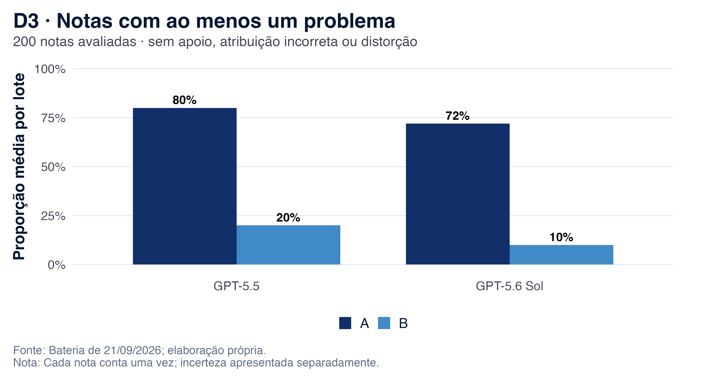

<!--
[Sources]
- /Users/lucasthevenard/Repo/participacao_social/ia_participacao_social/entrega_slides_oficina_2026-09-23/graficos/D3_notas.png
- /Users/lucasthevenard/Repo/participacao_social/ia_participacao_social/entrega_slides_oficina_2026-09-23/scripts/graficos.R
- /Users/lucasthevenard/Repo/participacao_social/ia_participacao_social/entrega_slides_oficina_2026-09-23/analises/resumo.csv
-->

---

<!-- _footer: "" -->
<!-- _paginate: false -->
<!-- _class: figure no-footer -->

## D23 extensao

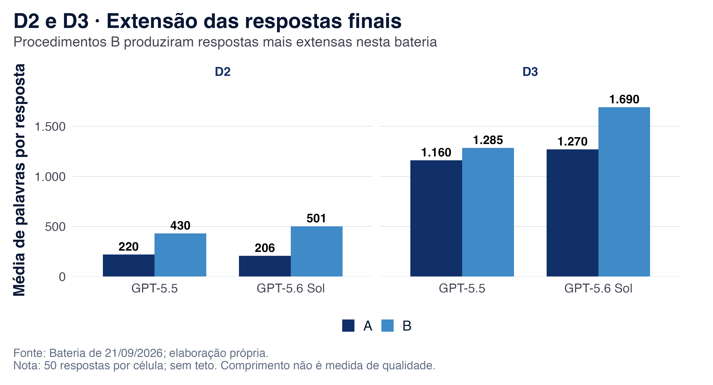

<!--
[Sources]
- /Users/lucasthevenard/Repo/participacao_social/ia_participacao_social/entrega_slides_oficina_2026-09-23/graficos/D23_extensao.png
- /Users/lucasthevenard/Repo/participacao_social/ia_participacao_social/entrega_slides_oficina_2026-09-23/scripts/graficos.R
- /Users/lucasthevenard/Repo/participacao_social/ia_participacao_social/entrega_slides_oficina_2026-09-23/analises/resumo.csv
-->

---

<!-- _class: dense -->

## D3 · Uma posição que impede o consenso

> Não. Sugerimos retirar as salvaguardas mínimas para evitar problemas adicionais decorrentes de critérios em aberto e limitações de dados.

**Fonte:** FS-C047 · questão 4 · entrada D3/L09.

<!--
[Sources]
- /Users/lucasthevenard/Repo/participacao_social/ia_participacao_social/entrega_slides_oficina_2026-09-23/exemplos/fontes/D3_L09_FS-C047.md
- Citação literal contínua, conferida por correspondência exata. FS-C047 · questão 4 · entrada D3/L09.
-->

---

<!-- _class: dense -->

## D3 · Uma alternativa vira convergência

> Entre os participantes que pedem alterações, há convergência quanto a:

**Entre os itens dessa lista:**

> - conveniência de preservar, em alguma medida, exclusões relativas a armas controversas e violações de padrões internacionais de conduta empresarial.

**Fonte:** D3 · L09_R03_gpt-5.6-sol_A.

O avaliador marcou A023 como distorcida. FS-C047 pede retirar as salvaguardas; a abertura da lista amplia indevidamente o alcance do consenso.

<!--
[Sources]
- /Users/lucasthevenard/Repo/participacao_social/ia_participacao_social/testes_minuta_definitiva_2026-09-21/D3/PROTOCOLO.json
- /Users/lucasthevenard/Repo/participacao_social/ia_participacao_social/entrega_slides_oficina_2026-09-23/analises/INTEGRIDADE.json
- Resultados preliminares por IA; conferência documental do assistente não equivale a revisão humana.
- Dois trechos literais não contíguos da mesma lista; itens intermediários omitidos.
-->

---

<!-- _class: dense -->

## D3 · B explicita a ausência de consenso

> Não há, portanto, alternativa consensual no lote. Também não há uniformidade entre os participantes sobre quais exclusões deveriam permanecer ou sobre a substituição das exclusões por critérios de governança ou de consideração dos principais impactos adversos.

**Fonte:** D3 · L09_R03_gpt-5.6-sol_B.

B usa matriz, nota e revisão. Na síntese anterior a esse trecho, identifica separadamente as alternativas e registra o pedido de retirada de FS-C047. A distinção pode ser conferida na saída integral.

<!--
[Sources]
- /Users/lucasthevenard/Repo/participacao_social/ia_participacao_social/testes_minuta_definitiva_2026-09-21/D3/execucoes/L09_R03_gpt-5.6-sol_B/SAIDA.md
- Citação literal contínua, conferida por correspondência exata. D3 · L09_R03_gpt-5.6-sol_B.
-->

---

## D4 · Classificar é aplicar uma definição

Uma classificação depende de um objeto e de critérios. Apoiar limites quantitativos em geral não equivale a aceitar o percentual de 80% como proposto.

Davani, Díaz e Prabhakaran (2022) mostram por que desacordos em tarefas subjetivas podem conter informação, em vez de serem tratados automaticamente como ruído.

Isso não torna todo rótulo igualmente adequado: precisamos explicitar a regra, apresentar a evidência e examinar os casos de desacordo.

<!--
[Sources]
- Davani, Díaz e Prabhakaran (2022), Dealing with Disagreements. https://doi.org/10.1162/tacl_a_00449. SRC0644. Discussão de anotação subjetiva, não validação específica dos nossos rótulos.
-->

---

## D4 · Categorias e procedimentos

Questão 2: 72 participantes, dez lotes de sete ou oito; dois modelos, cinco repetições: **300 tabelas e 2.160 linhas**.

**A:** favorável, contrária ou neutra.

**B:** acrescenta “favorável sob condições”.

**C:** mantém quatro categorias e explicita objeto, definições, evidência textual e sinalização de ambiguidade. Cada condição usa um único turno.

Antes dos resultados: aumentar as categorias deveria aumentar a concordância? Por quê?

<!--
[Sources]
- /Users/lucasthevenard/Repo/participacao_social/ia_participacao_social/testes_minuta_definitiva_2026-09-21/D4/PROTOCOLO.json
- /Users/lucasthevenard/Repo/participacao_social/ia_participacao_social/entrega_slides_oficina_2026-09-23/analises/INTEGRIDADE.json
- Resultados preliminares por IA; conferência documental do assistente não equivale a revisão humana.
-->

---

<!-- _class: dense -->

## D4 · prompt A, etapa 1

> Você integra a equipe técnica de análise de uma consulta pública sobre nomes de fundos de investimento. Use exclusivamente a minuta e as contribuições fornecidas. O lote identifica a questão em análise; outras seções esclarecem suas remissões e ambiguidades. Classifique cada contribuição como favorável, contrária ou neutra em relação ao piso de 80%. Entregue uma tabela com ID, classificação e uma justificativa de uma frase.

**Fonte:** D4 · condição A · etapa 1.

A primeira etapa recebeu também a minuta e as contribuições integrais do lote.

<!--
[Sources]
- /Users/lucasthevenard/Repo/participacao_social/ia_participacao_social/testes_minuta_definitiva_2026-09-21/D4/prompts/A_etapa_1.txt
- Citação literal contínua, conferida por correspondência exata. D4 · condição A · etapa 1.
-->

---

<!-- _class: dense -->

## D4 · prompt B, etapa 1

> Você integra a equipe técnica de análise de uma consulta pública sobre nomes de fundos de investimento. Use exclusivamente a minuta e as contribuições fornecidas. O lote identifica a questão em análise; outras seções esclarecem suas remissões e ambiguidades. Classifique cada contribuição como favorável, favorável sob condições, contrária ou neutra em relação ao piso de 80%. Entregue uma tabela com ID, classificação e uma justificativa de uma frase.

**Fonte:** D4 · condição B · etapa 1.

A primeira etapa recebeu também a minuta e as contribuições integrais do lote.

<!--
[Sources]
- /Users/lucasthevenard/Repo/participacao_social/ia_participacao_social/testes_minuta_definitiva_2026-09-21/D4/prompts/B_etapa_1.txt
- Citação literal contínua, conferida por correspondência exata. D4 · condição B · etapa 1.
-->

---

<!-- _class: dense -->

## D4 · prompt C, etapa 1 (1/2)

> Você integra a equipe técnica de análise de uma consulta pública sobre nomes de fundos de investimento. Use exclusivamente a minuta e as contribuições fornecidas. O lote identifica a questão em análise; outras seções esclarecem suas remissões e ambiguidades. Classifique cada contribuição como favorável, favorável sob condições, contrária ou neutra em relação ao piso de 80%. Entregue uma tabela com ID, classificação e uma justificativa de uma frase. O objeto é a adequação do percentual de 80% como proposto, e não o apoio genérico a combater greenwashing.

**Fonte:** D4 · condição C · etapa 1.

<!--
[Sources]
- /Users/lucasthevenard/Repo/participacao_social/ia_participacao_social/testes_minuta_definitiva_2026-09-21/D4/prompts/C_etapa_1.txt
- Citação literal contínua, conferida por correspondência exata. D4 · condição C · etapa 1.
-->

---

<!-- _class: dense -->

## D4 · prompt C, etapa 1 (2/2)

> Use favorável para aceitação do patamar, inclusive ressalvas operacionais que não condicionem sua aceitação; favorável sob condições para aceitação expressamente dependente de alterar a proposta; contrária para rejeição ou substituição; neutra para ausência de posição identificável. Diferencie condição substantiva de recomendação acessória, cite um trecho na justificativa e sinalize eventuais ambiguidades.

**Fonte:** D4 · condição C · etapa 1.

A primeira etapa recebeu também a minuta e as contribuições integrais do lote.

<!--
[Sources]
- /Users/lucasthevenard/Repo/participacao_social/ia_participacao_social/testes_minuta_definitiva_2026-09-21/D4/prompts/C_etapa_1.txt
- Citação literal contínua, conferida por correspondência exata. D4 · condição C · etapa 1.
-->

---

<!-- _class: dense -->

## D4 · Indicadores para tarefas de classificação

- **Distribuição:** quantidade de cada rótulo nas 360 linhas por modelo e condição.
- **Estabilidade:** mesmo rótulo válido nas cinco repetições de um participante.
- **Mudança:** prompts distintos alteram o rótulo nos pares válidos.

<!--
[Sources]
- /Users/lucasthevenard/Repo/participacao_social/ia_participacao_social/testes_minuta_definitiva_2026-09-21/D4/PROTOCOLO.json
- /Users/lucasthevenard/Repo/participacao_social/ia_participacao_social/entrega_slides_oficina_2026-09-23/analises/INTEGRIDADE.json
- Resultados preliminares por IA; conferência documental do assistente não equivale a revisão humana.
-->

---

<!-- _footer: "" -->
<!-- _paginate: false -->
<!-- _class: figure no-footer -->

## D4 distribuicao

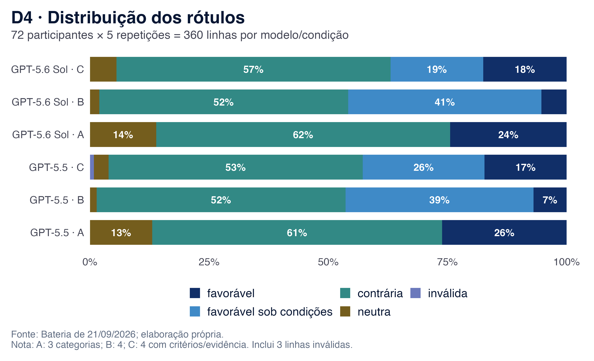

<!--
[Sources]
- /Users/lucasthevenard/Repo/participacao_social/ia_participacao_social/entrega_slides_oficina_2026-09-23/graficos/D4_distribuicao.png
- /Users/lucasthevenard/Repo/participacao_social/ia_participacao_social/entrega_slides_oficina_2026-09-23/scripts/graficos.R
- /Users/lucasthevenard/Repo/participacao_social/ia_participacao_social/entrega_slides_oficina_2026-09-23/analises/resumo.csv
-->

---

<!-- _footer: "" -->
<!-- _paginate: false -->
<!-- _class: figure no-footer -->

## D4 estabilidade

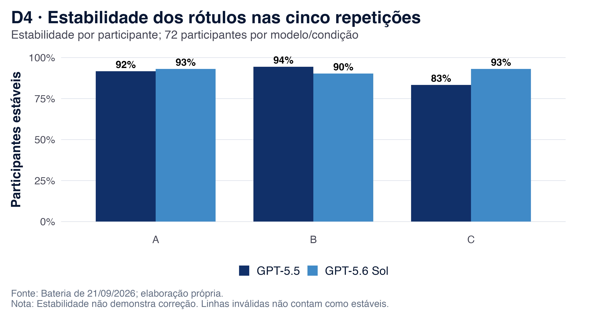

<!--
[Sources]
- /Users/lucasthevenard/Repo/participacao_social/ia_participacao_social/entrega_slides_oficina_2026-09-23/graficos/D4_estabilidade.png
- /Users/lucasthevenard/Repo/participacao_social/ia_participacao_social/entrega_slides_oficina_2026-09-23/scripts/graficos.R
- /Users/lucasthevenard/Repo/participacao_social/ia_participacao_social/entrega_slides_oficina_2026-09-23/analises/resumo.csv
-->

---

<!-- _footer: "" -->
<!-- _paginate: false -->
<!-- _class: figure no-footer -->

## D4 mudancas

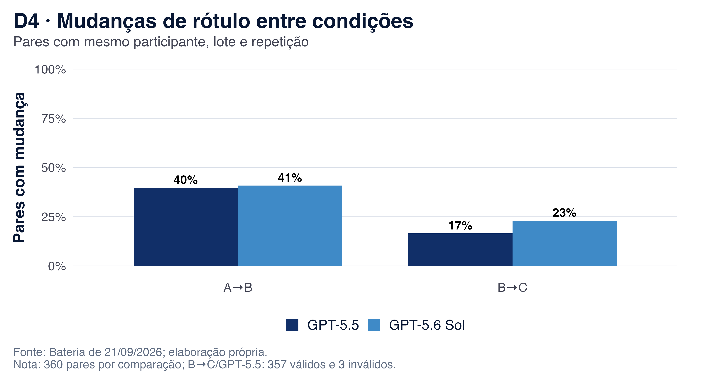

<!--
[Sources]
- /Users/lucasthevenard/Repo/participacao_social/ia_participacao_social/entrega_slides_oficina_2026-09-23/graficos/D4_mudancas.png
- /Users/lucasthevenard/Repo/participacao_social/ia_participacao_social/entrega_slides_oficina_2026-09-23/scripts/graficos.R
- /Users/lucasthevenard/Repo/participacao_social/ia_participacao_social/entrega_slides_oficina_2026-09-23/analises/resumo.csv
-->

---

<!-- _class: table -->

## Classificação: acurácia e qualidade das justificativas

| Modelo | Prompt | IC Reliability | Justificativa Completa/Adequada |
|---|---|---|---|
| GPT 5.5 | A | 67.7% | 42.5% |
| GPT 5.5 | B | 89.3% | 72.1% |
| GPT 5.5 | C | 90.4% | 86.6% |
| GPT 5.6 Sol | A | 64.6% | 41.4% |
| GPT 5.6 Sol | B | 92.2% | 80.1% |
| GPT 5.6 Sol | C | 93.1% | 88.9% |

---

## D4 · Critérios mudam as classificações

Adicionar a categoria condicional mudou aproximadamente 40% dos rótulos entre A e B. Entre B e C, mudaram 17% no GPT-5.5 e 23% no GPT-5.6 Sol, entre pares válidos.

A estabilidade não aumentou de forma uniforme.

<!--
[Sources]
- /Users/lucasthevenard/Repo/participacao_social/ia_participacao_social/testes_minuta_definitiva_2026-09-21/D4/PROTOCOLO.json
- /Users/lucasthevenard/Repo/participacao_social/ia_participacao_social/entrega_slides_oficina_2026-09-23/analises/INTEGRIDADE.json
- Resultados preliminares por IA; conferência documental do assistente não equivale a revisão humana.
-->

---

<!-- _class: dense -->

## D4 · Uma aceitação expressamente condicionada

> Esta associação considera razoável a implementação de um limite quantitativo de 80% para o uso de quaisquer palavras relacionadas a ESG na denominação de um fundo, desde que, no caso de fundos de investimento imobiliário não listados, a metodologia empregada para avaliar se o limite foi atingido considere a metodologia proposta por esta associação em sua resposta à questão 1.

**Fonte:** FS-C023 · questão 2 · entrada D4/L01.

A remissão à questão 1 integra a fonte disponibilizada. A auditoria precisa ler essa metodologia antes de aceitar a justificativa.

<!--
[Sources]
- /Users/lucasthevenard/Repo/participacao_social/ia_participacao_social/entrega_slides_oficina_2026-09-23/exemplos/fontes/D4_L01_FS-C023.md
- Citação literal contínua, conferida por correspondência exata. FS-C023 · questão 2 · entrada D4/L01.
-->

---

<!-- _class: dense -->

## D4 · FS-C023 na condição A

> | FS-C023 | Favorável | Considera razoável o piso de 80%, condicionado à adoção de metodologia específica para fundos imobiliários não listados. |

**Fonte:** D4 · L01_R01_gpt-5.6-sol_A.

A não oferece uma categoria condicional. A justificativa menciona a condição, embora o rótulo seja “Favorável”.

<!--
[Sources]
- /Users/lucasthevenard/Repo/participacao_social/ia_participacao_social/testes_minuta_definitiva_2026-09-21/D4/execucoes/L01_R01_gpt-5.6-sol_A/SAIDA.md
- Citação literal contínua, conferida por correspondência exata. D4 · L01_R01_gpt-5.6-sol_A.
-->

---

<!-- _class: dense -->

## D4 · FS-C023 na condição B

> | FS-C023 | Favorável sob condições | Considera razoável o piso de 80%, desde que, para fundos imobiliários não listados, o cálculo exclua também as contas a receber. |

**Fonte:** D4 · L01_R01_gpt-5.6-sol_B.

Com a categoria adicional, o rótulo passa a registrar a condição. Isso recupera uma distinção que A só trazia na justificativa.

<!--
[Sources]
- /Users/lucasthevenard/Repo/participacao_social/ia_participacao_social/testes_minuta_definitiva_2026-09-21/D4/execucoes/L01_R01_gpt-5.6-sol_B/SAIDA.md
- Citação literal contínua, conferida por correspondência exata. D4 · L01_R01_gpt-5.6-sol_B.
-->

---

<!-- _class: dense -->

## D4 · FS-C023 na condição C

> | FS-C023 | Favorável sob condições | Considera o limite de 80% “razoável”, mas condiciona expressamente sua aceitação, para fundos imobiliários não listados, à adoção da metodologia proposta na questão 1, com exclusão de contas a receber do cálculo. |

**Fonte:** D4 · L01_R01_gpt-5.6-sol_C.

C exige critérios e trecho de apoio. O rótulo continua condicional; a correção semântica depende também de conferir a remissão à questão 1.

<!--
[Sources]
- /Users/lucasthevenard/Repo/participacao_social/ia_participacao_social/testes_minuta_definitiva_2026-09-21/D4/execucoes/L01_R01_gpt-5.6-sol_C/SAIDA.md
- Citação literal contínua, conferida por correspondência exata. D4 · L01_R01_gpt-5.6-sol_C.
-->

---

<!-- _class: table -->

## O que os quatro testes ensinam

| Tarefa | Controle que o resultado exige |
|---|---|
| Síntese | Confrontar a saída com um inventário de razões, inclusive pouco frequentes |
| Agrupamento | Conferir cada proposta e justificativa contra todos os IDs associados |
| Nota | Separar minuta, manifestação e informação ausente |
| Classificação | Definir objeto e critérios; examinar ambiguidades e rótulos inválidos |

 

> **Procedimentos com verificações adicionais podem ajudar, mas continuam produzindo erros.**

<!--
[Sources]
- Protocolos e análises D1–D4 da bateria de 21/09/2026.
-->

---

## Da evidência experimental ao uso administrativo

Os testes não mediram tempo total de trabalho, custo de revisão, qualidade de decisões públicas ou legitimidade da participação.

Uma avaliação administrativa precisa considerar **produção, conferência, correção e possibilidade de contestação**.

O uso responsável exige conservar as fontes e tornar visíveis os pontos em que houve julgamento. O texto final continua sendo responsabilidade da equipe.

<!--
[Sources]
- Síntese analítica da oficina. Não é resultado medido pela bateria.
-->

---

## Exercício · Das contribuições à nota

Trabalhem em grupos com a minuta, as perguntas e seis contribuições completas:

**FS-C013 · FS-C023 · FS-C028 · FS-C037 · FS-C057 · FS-C088**

Produzam uma nota temática de até 500 palavras, com propostas, convergências, divergências e ressalvas ligadas aos IDs e trechos das fontes.

Materiais: pasta **03_Exercicio**, arquivo **Roteiro.md**. Os seis textos formam uma seleção didática, não uma amostra representativa.

<!--
[Sources]
- /Users/lucasthevenard/Repo/participacao_social/ia_participacao_social/materiais_alunos_oficina_2026-09-23/03_Exercicio/Roteiro.md
- /Users/lucasthevenard/Repo/participacao_social/ia_participacao_social/preparacao_materiais_alunos_2026-09-23/REFERENCIA_FACILITADOR.md
- Fluxo didático adaptado; não reproduz a sequência completa de um protocolo experimental.
-->

---

<!-- _class: table -->

## Um fluxo didático adaptado

| Etapa | Produto a conferir |
|---|---|
| 1. Inventário | Temas, propostas, argumentos, condições, IDs e trechos |
| 2. Agrupamento | Propostas comuns e diferenças com seus respectivos IDs |
| 3. Matriz | Afirmação, categoria, fonte e evidência |
| 4. Nota breve | Síntese temática e quadro de rastreabilidade |
| 5. Confronto | Nota corrigida e dúvidas remanescentes |
| 6. Auditoria humana | Decisões e correções justificadas nos originais |

Os prompts adaptam B de D1–D3. Essa cadeia nova não foi testada como um procedimento único.

<!--
[Sources]
- /Users/lucasthevenard/Repo/participacao_social/ia_participacao_social/materiais_alunos_oficina_2026-09-23/03_Exercicio/Roteiro.md
- /Users/lucasthevenard/Repo/participacao_social/ia_participacao_social/preparacao_materiais_alunos_2026-09-23/REFERENCIA_FACILITADOR.md
- Fluxo didático adaptado; não reproduz a sequência completa de um protocolo experimental.
-->

---

## Pontos para examinar durante o exercício

- Uma crítica ao mecanismo de limites foi confundida com rejeição do patamar de 80%?
- Uma remissão a outra questão foi lida por inteiro?
- Uma ressalva ou sugestão foi convertida em condição indispensável?
- Participantes agrupados num tema defendem a mesma proposta sobre cada inciso?
- Ausência de resposta foi confundida com apoio, oposição ou ausência declarada de opinião?

Apontem o ID e o trecho que sustentam cada observação.

<!--
[Sources]
- /Users/lucasthevenard/Repo/participacao_social/ia_participacao_social/materiais_alunos_oficina_2026-09-23/03_Exercicio/Roteiro.md
- /Users/lucasthevenard/Repo/participacao_social/ia_participacao_social/preparacao_materiais_alunos_2026-09-23/REFERENCIA_FACILITADOR.md
- Fluxo didático adaptado; não reproduz a sequência completa de um protocolo experimental.
-->

---

## Discussão final

Qual erro teria maior consequência se a nota fosse usada para decidir?

Que parte do trabalho exigiu mais tempo de conferência? O procedimento tornou esse trabalho mais fácil de executar e explicar?

Como um participante poderia localizar sua manifestação, entender como ela foi tratada e pedir uma correção?

A utilidade do apoio por IA deve ser avaliada também por essas respostas.

<!--
[Sources]
- Perguntas de facilitação; não são resultados empíricos da bateria.
-->
